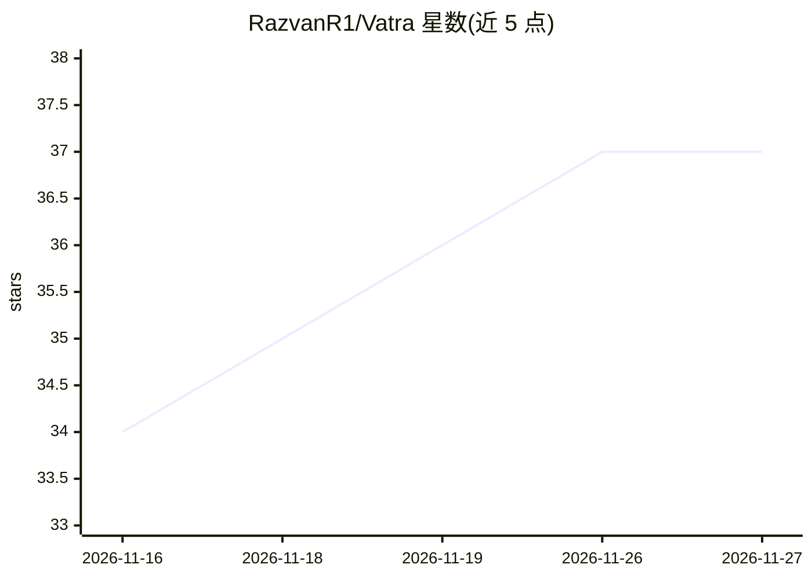

# RazvanR1/Vatra

⭐ 37 · Python · MIT · 推送 2026-11-26 · [GitHub](https://github.com/RazvanR1/Vatra) · 个人维护 · 中文 README

**Home Assistant 本地化智能大脑：学习惯、辨异常、可选本地 AI 代理**

Home Assistant 的 add-on（需 HA OS/Supervised），从人的操作中学习时间型与序列型习惯，先在历史数据上回测再以原生 HA 自动化形式提议（带批准/撤销）；按小时基线检测异常、看门狗、假期模式、设备清理，并通过 Companion App 发送可操作通知。安全护栏不可绕过：锁/报警/阀门等必须批准，Shell 命令与重启 HA 直接禁止。AI 为可选功能：气候/能源/安全/服务器本地代理与 Jarvis 语音对话可接 Ollama 或任意 OpenAI 兼容服务器；无 AI 时除代理与 Jarvis 外全部功能可用。数据存本地 SQLite，无云无遥测。支持英/罗/匈三语。

## 筛选速览

| 维度 | 判定 | 备注 |
|---|---|---|
| AI 角色 | `ai-enhanced` | 去掉 AI 部分产品仍成立 |
| 许可风险 | `permissive` | MIT |
| 部署形态 | `library` | 以包/库形式分发 |
| 模型依赖 | local-ok | 支持本地模型 |
| 硬件要求 | — | 无带数字的原话,不猜 |
| 安装摩擦 | `low` | 无编译、无系统依赖或容器化 |
| 成熟度 | — | 结构信号不足 |

## 能力要点

- 习惯学习仅基于人的操作（含来源追踪），回测通过后才提议原生 HA 自动化
- 按小时基线的异常检测：异常值、沉默传感器、设备抖动、离家门窗未关
- 不可绕过的安全护栏与 shadow/copilot/autonomous 三档自主级别
- 本地 AI 代理与 Jarvis 语音（Ollama 或 OpenAI 兼容服务器），无 AI 也可运行

## 适用场景

- 让家庭自动化从日常习惯中自动生成并经手机批准生效
- 无阈值配置地发现家里的异常与失效设备
- 用本地 AI 代理分析家居能耗/安全并语音询问房屋状态

## 场景标签

`工作流自动化` `语音 Agent` `AI 助手` · 领域:效率与自动化

## 证据(README 行号)

> L14: Everything runs on your hardware. The AI part (Ollama) is optional and only used when it adds value.
> L70:  (tested with `qwen3.5:9b` on a 12 GB GPU). Without it, everything except the agents and Jarvis still works.

## 星数曲线

2026-11-16 34 → 2026-11-27 37（+3）

---
*卡片 v1 · prompt 1.4 · 生成 2026-11-18 · 置信度 mid · 依据 README sha `87aede5e1fa0` · [字段定义](../../DATASET.md)*
