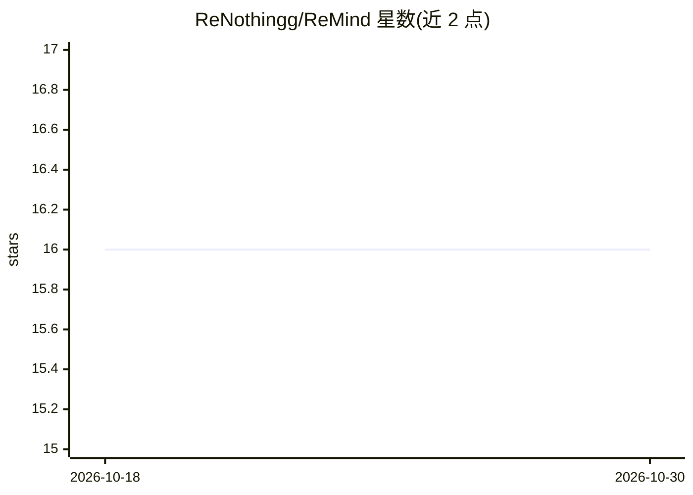

# ReNothingg/ReMind

⭐ 16 · TypeScript · NOASSERTION · 推送 2026-10-16 · [GitHub](https://github.com/ReNothingg/ReMind) · [官网](https://chat.synvexai.com) · 个人维护

**自托管的流式 AI 聊天工作台（React+Flask 全栈应用）**

面向终端用户的 AI 聊天应用：React 19/Vite 前端加 Flask 后端，提供 SSE 流式对话、会话历史与只读分享链接、访客/注册双模式（Google OAuth、Telegram Login）、Telegram 机器人同步通道。内置聊天工具运行时（33 个工具函数：文件读写、CSV/JSON 分析、Web 检索、GitHub 读取、Canvas 编辑），带调用轮次与文件大小限制，Python 在隔离 runner 中执行。附翻译、Google Translate TTS 语音合成端点，以及数据导出/删除的隐私流程。通过 AI provider adapter 接入模型，需配置 AI_PROVIDER_API_KEY；本地冒烟测试可用内置 echo/demo_image。提供 Docker Compose 的开发与生产配置（Nginx+PostgreSQL+Redis+Celery）。

## 筛选速览

| 维度 | 判定 | 备注 |
|---|---|---|
| AI 角色 | `ai-native` | 本体是模型或模型工具 |
| 许可风险 | `none` | NOASSERTION |
| 部署形态 | `self-host` | docker 或自建部署 |
| 模型依赖 | — | README 未给出锁定关系 |
| 硬件要求 | — | 无带数字的原话,不猜 |
| 安装摩擦 | `low` | 无编译、无系统依赖或容器化 |
| 成熟度 | — | 结构信号不足 |

## 能力要点

- SSE 流式聊天、会话历史与只读分享链接
- 33 个内置聊天工具（文件、CSV/JSON、Web 检索、Canvas 编辑、隔离 Python runner）
- 访客/注册双模式，Google OAuth 与 Telegram Login OIDC，Telegram 机器人同步通道
- Docker Compose 开发与生产配置（Nginx/PostgreSQL/Redis/Celery），含 metrics 与健康检查

## 适用场景

- 自托管一个带账号体系和分享功能的 AI 聊天服务
- 通过对话让 AI 分析文件、表格并做 Web 检索
- 在 Telegram 中同步使用同一聊天工作台

## 场景标签

`聊天机器人` `AI 助手` · 领域:对话与助手

## 证据(README 行号)

> L30: **ReMind** это AI-приложение на React/Vite и Flask, собранное как продуктовая база: streaming chat, сохранение сесс
> L42: - Streaming AI chat через `POST /chat` с server-sent events.

## 星数曲线

2026-10-18 16 → 2026-10-30 16（+0）

---
*卡片 v1 · prompt 1.4 · 生成 2026-10-30 · 置信度 mid · 依据 README sha `e5d956a50484` · [字段定义](../../DATASET.md)*
