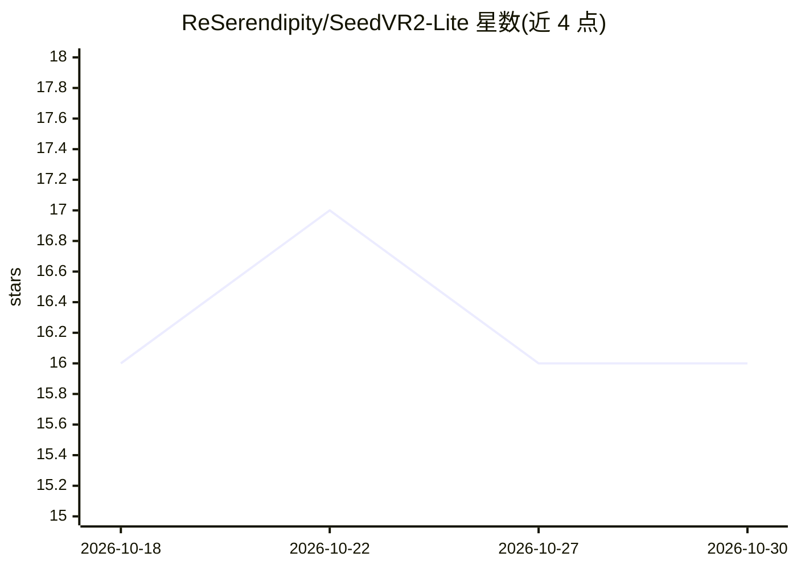

# ReSerendipity/SeedVR2-Lite

⭐ 16 · Python · Apache-2.0 · 推送 2026-10-29 · [GitHub](https://github.com/ReSerendipity/SeedVR2-Lite) · 个人维护 · 中文 README

**本地视频/图像超分修复工具箱：上传即得 SeedVR2 修复结果**

把字节跳动 Seed 团队与南洋理工大学 S-Lab 联合开源的 SeedVR2 单步扩散修复模型包装成独立本地 Web 应用：上传图片或视频，本地完成超分辨率与细节增强，数据不出机器，不依赖 ComfyUI。提供 Tauri v2 桌面离线包（解压即用、增量更新）与源码/便携包运行方式。支持 3B/7B/7B-Sharp 三档模型、FP8 与多种量化变体、GPU Block Swap（3B FP8 最低 8 GB 显存）、批量与断点续跑。限制：必须 NVIDIA CUDA GPU、不支持纯 CPU 推理，仅 Windows 推荐（Linux 经 Docker），视频修复需自装 FFmpeg。

## 筛选速览

| 维度 | 判定 | 备注 |
|---|---|---|
| AI 角色 | `ai-native` | 本体是模型或模型工具 |
| 许可风险 | `permissive` | Apache-2.0 |
| 部署形态 | `self-host` | docker 或自建部署 |
| 模型依赖 | — | README 未给出锁定关系 |
| 硬件要求 | — | 无带数字的原话,不猜 |
| 安装摩擦 | `low` | 无编译、无系统依赖或容器化 |
| 成熟度 | — | 结构信号不足 |

## 能力要点

- 3B/7B/7B-Sharp 模型，FP16/FP8 及 MXFP8/NVFP4/INT8 量化变体
- GPU Block Swap，3B FP8 最低 8 GB 显存起步
- 桌面版解压即用，托盘增量更新
- 文件夹批量扫描与断点续跑（进度存 data/checkpoints/）

## 适用场景

- 把低分辨率视频/图片在本地做超分与细节增强
- 在显存有限的机器上（8-12GB）跑扩散修复
- 批量处理整个文件夹的素材并中断续跑

## 场景标签

`图像视频处理` · 领域:感知与多模态

## 证据(README 行号)

> L23: SeedVR2-Lite 把字节跳动 Seed 团队与南洋理工大学 S-Lab 联合开源的 SeedVR2 单步扩散修复模型，包装成一个**独立运行的本地 Web 应用**：上传一张图片或一段视频，即可完成超分辨率与细节增强，数据
> L29: - **视频与图像修复**：基于单步扩散模型的超分辨率与细节增强，本地推理、数据不出机器。

## 星数曲线

2026-10-18 16 → 2026-10-30 16（+0）

---
*卡片 v1 · prompt 1.4 · 生成 2026-10-30 · 置信度 mid · 依据 README sha `249afd51a95b` · [字段定义](../../DATASET.md)*
