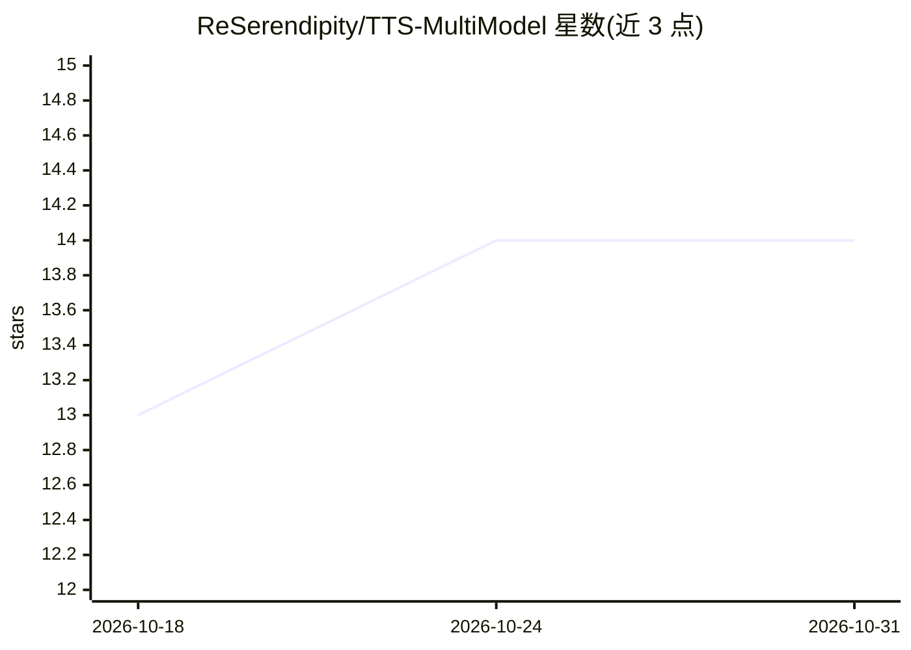

# ReSerendipity/TTS-MultiModel

⭐ 14 · Python · Apache-2.0 · 推送 2026-10-30 · [GitHub](https://github.com/ReSerendipity/TTS-MultiModel) · 组织维护 · 中文 README

**自托管多引擎 TTS 平台：六本地引擎统一 Web 工作台**

自托管的语音合成平台，将 VoxCPM2、IndexTTS 2.5/2.0、OpenVoice、Step-Audio-EditX、Breeze TTS 2 六套本地引擎与 Edge-TTS 在线兜底引擎统一到 FastAPI + HTMX Web 界面，面向需要声音克隆、声音设计、多角色剧本配音、语音转换与音频编辑的用户。支持 CUDA/MPS/CPU 自动适配、SSE 流式输出、SQLite 历史与 OpenAI 兼容 API。代码 Apache-2.0 但不打包模型权重，需自行下载且各权重许可不同（部分限非商用）；LoRA 训练链路为实验特性。

## 筛选速览

| 维度 | 判定 | 备注 |
|---|---|---|
| AI 角色 | `ai-native` | 本体是模型或模型工具 |
| 许可风险 | `permissive` | Apache-2.0 |
| 部署形态 | `self-host` | docker 或自建部署 |
| 模型依赖 | — | README 未给出锁定关系 |
| 硬件要求 | `cpu-ok` | |
| 安装摩擦 | `low` | 无编译、无系统依赖或容器化 |
| 成熟度 | — | 结构信号不足 |

## 能力要点

- 六套本地引擎 + Edge-TTS CPU 兜底，声明式引擎注册表切换
- 零样本/极致声音克隆与自然语言声音设计
- 多角色剧本配音、SSE 流式与批量断点续跑
- 提供 Web UI / CLI / OpenAI 兼容 API（POST /v1/audio/speech）

## 适用场景

- 在一个工作台里切换多个开源 TTS 引擎合成语音
- 用参考音频克隆音色或用文字描述直接生成音色
- 为多角色对话剧本批量配音并逐条试听
- 无 GPU 时用 Edge-TTS 在线引擎体验完整界面

## 场景标签

`语音合成` · 领域:内容生成

## 证据(README 行号)

> L23: **TTS MultiModel** 是一个自托管的多引擎语音合成（TTS）平台。它把 VoxCPM2、IndexTTS 2.5、IndexTTS 2.0、OpenVoice、Step-Audio-EditX、Breeze TTS
> L29: - **六引擎统一编排**：声明式引擎注册表，VoxCPM2 / IndexTTS 2.5 / IndexTTS 2.0 / OpenVoice / Step-Audio-EditX / Breeze TTS 2 灵活切换；Edg
> L66: **环境要求**：Windows 10/11 (64-bit) 或 Linux；Python 3.10+（推荐 3.12）；本地引擎建议 NVIDIA GPU（6.5 GB+ 显存），无 GPU 时可用 Edge-TTS 在线引擎

## 星数曲线

2026-10-18 13 → 2026-10-31 14（+1）

---
*卡片 v1 · prompt 1.4 · 生成 2026-10-31 · 置信度 mid · 依据 README sha `5054ba5105a9` · [字段定义](../../DATASET.md)*
