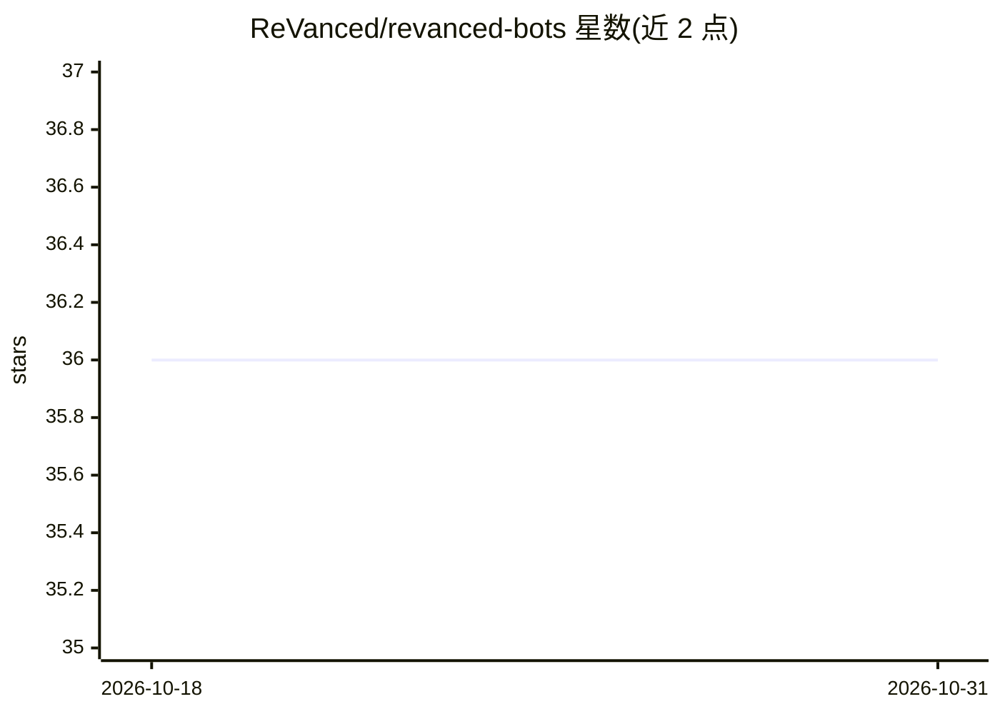

# ReVanced/revanced-bots

⭐ 36 · TypeScript · 推送 2026-06-21 · [GitHub](https://github.com/ReVanced/revanced-bots) · [官网](https://revanced.app) · 组织维护

**辅助 ReVanced 社区的多平台 NLP 机器人集合**

ReVanced 组织维护的机器人项目集合，在 Discord、Telegram 等多个平台提供辅助 ReVanced 社区的机器人服务；主题标签显示涉及 fastText 文本分类与 OCR。代码以 TypeScript 编写，运行于 Bun JavaScript 运行时，仓库下分 apis、bots、packages 三个目录组织子项目。README 信息有限，具体机器人功能与部署方式需查阅项目文档。

## 筛选速览

| 维度 | 判定 | 备注 |
|---|---|---|
| AI 角色 | `ai-native` | 本体是模型或模型工具 |
| 许可风险 | `none` | — |
| 部署形态 | `None` |  |
| 模型依赖 | — | README 未给出锁定关系 |
| 硬件要求 | — | 无带数字的原话,不猜 |
| 安装摩擦 | `low` | 无编译、无系统依赖或容器化 |
| 成熟度 | — | 结构信号不足 |

## 能力要点

- 多平台运行的社区辅助机器人
- 主题标签涉及 fastText 与 OCR
- TypeScript 编写，基于 Bun 运行时

## 适用场景

- 为 ReVanced 社区频道提供自动化辅助
- 了解 ReVanced 组织的机器人子项目结构

## 场景标签

`聊天机器人` · 领域:对话与助手

## 证据(README 行号)

> L35: # 🤖 ReVanced Bots
> L37: Bots assisting ReVanced on multiple platforms.
> L41: Thank you for considering! This project is made in TypeScript and we use the Bun JavaScript runtime.

## 星数曲线

2026-10-18 36 → 2026-10-31 36（+0）

---
*卡片 v1 · prompt 1.4 · 生成 2026-10-25 · 置信度 low · 依据 README sha `1346a48c18a6` · [字段定义](../../DATASET.md)*
