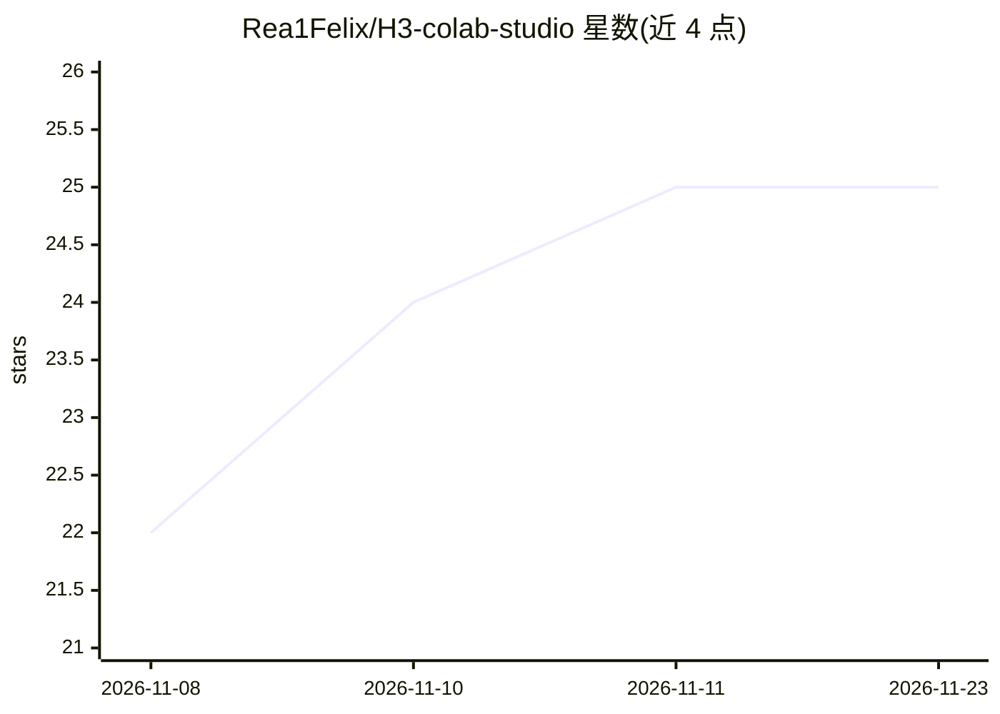

# Rea1Felix/H3-colab-studio

⭐ 25 · Shell · MIT · 推送 2026-11-06 · [GitHub](https://github.com/Rea1Felix/H3-colab-studio) · 个人维护 · 中文 README

**让 agent 在 Colab G4 上搭建并运行 MiniMax H3 多镜头视频工作台的技能/插件**

面向 Antigravity、Claude Code、OpenSkills 等 agent 框架的技能与插件包：提供控制台 Web 应用蓝图（任务队列+提示词草稿预览）、H3 多镜头提示词结构规范，以及经实测验证的 Colab G4 运行手册——单次会话跑完全部镜头、两处 ComfyUI 预检修复、本地 ffmpeg 拼接与计算单元消耗追踪。GPU 生成在 Colab（RTX PRO 6000 Blackwell，约 96GB 显存）完成，需 Colab 计算单元与本地 ffmpeg；README 附有各分辨率/时长的实测耗时与算力消耗数据。

## 筛选速览

| 维度 | 判定 | 备注 |
|---|---|---|
| AI 角色 | `ai-ecosystem` | LLM/agent 周边工具 |
| 许可风险 | `permissive` | MIT |
| 部署形态 | `library` | 以包/库形式分发 |
| 模型依赖 | — | README 未给出锁定关系 |
| 硬件要求 | — | 无带数字的原话,不猜 |
| 安装摩擦 | `medium` | 含编译或系统依赖之一 |
| 成熟度 | — | 结构信号不足 |

## 能力要点

- MiniMax H3 一次生成仅单镜头，工作流用固定 noise_seed 与角色/色调锚点串接多镜头
- 实测 Colab G4 运行手册：预检修复、ffmpeg 拼接、ffprobe 校验、计算单元追踪
- 提供 .skill 打包、install.sh 一键安装、openskills/npx skills CLI 三种安装方式
- 记录多档分辨率/时长的实测采样耗时与 G4 消耗率（约 8.94 单位/小时）

## 适用场景

- 让 Claude Code 或 Antigravity agent 搭建本地提示词-转视频任务队列应用
- 把任意语言的想法转成结构化英文多镜头 H3 提示词
- 在单次 Colab G4 会话中渲染并拼接无水印多镜头短片

## 场景标签

`视频生成` `提示工程` · 领域:Agent 开发

## 证据(README 行号)

> L9: An agent skill and plugin for building and running a **MiniMax H3 Prompt-to-Video Workspace** bridged to **Google Co
> L22: │   └── h3-colab-studio/               # Universal Agent Skill (Antigravity, Claude Code, OpenSkills)

## 星数曲线

2026-11-08 22 → 2026-11-23 25（+3）

---
*卡片 v1 · prompt 1.4 · 生成 2026-11-18 · 置信度 high · 依据 README sha `f1804417fa57` · [字段定义](../../DATASET.md)*
