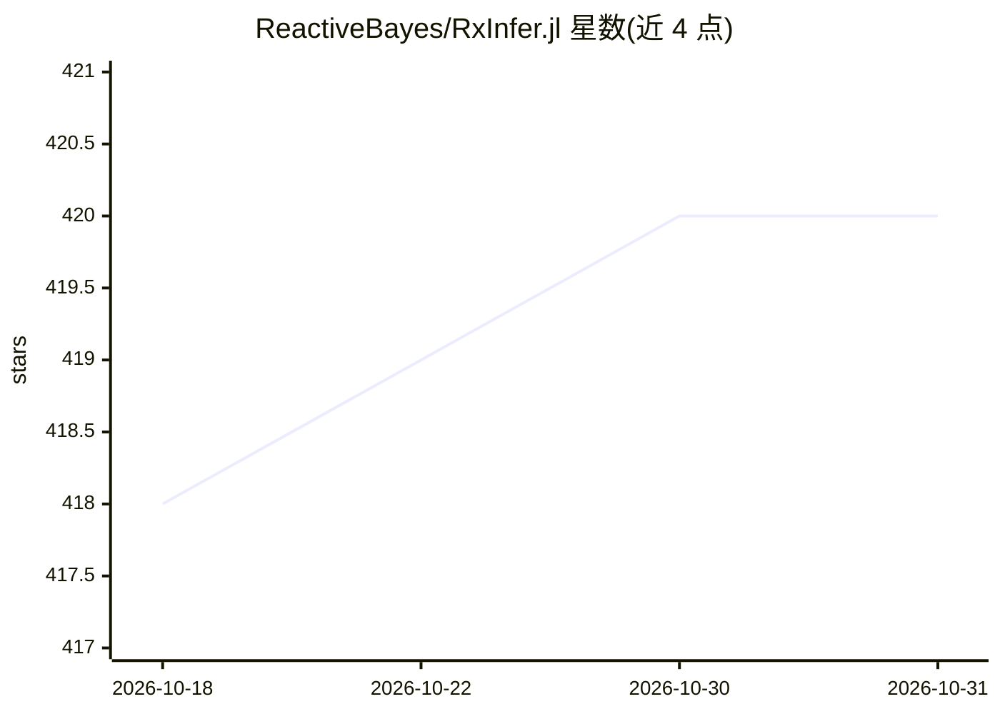

# ReactiveBayes/RxInfer.jl

⭐ 420 · Jupyter Notebook · MIT · 推送 2026-10-26 · [GitHub](https://github.com/ReactiveBayes/RxInfer.jl) · [官网](https://rxinfer.com/) · 组织维护

**Julia 贝叶斯推断包：因子图上的反应式消息传递推断**

RxInfer.jl 是面向 Julia 语言的自动贝叶斯推断包，基于因子图表示与反应式消息传递生成由局部计算组成的推断算法。用户以 GraphPPL 的 @model 宏定义概率模型，调用 infer 函数对静态数据集做推断；支持共轭先验-似然对的解析后验以降低计算负载，也支持非共轭推断。生态含 ReactiveMP（推断引擎）、GraphPPL、ExponentialFamily、Rocket 四个核心包。为 NumFocus 附属项目，收集可关闭的匿名遥测数据。通过 Julia 包管理器安装。

## 筛选速览

| 维度 | 判定 | 备注 |
|---|---|---|
| AI 角色 | `ai-native` | 本体是模型或模型工具 |
| 许可风险 | `permissive` | MIT |
| 部署形态 | `None` |  |
| 模型依赖 | — | README 未给出锁定关系 |
| 硬件要求 | — | 无带数字的原话,不猜 |
| 安装摩擦 | `low` | 无编译、无系统依赖或容器化 |
| 成熟度 | — | 结构信号不足 |

## 能力要点

- 因子图上的反应式消息传递自动生成推断算法
- 利用共轭配对已知解析后验，支持非共轭推断
- @model 宏以接近数学公式的语法定义模型
- 由 ReactiveMP/GraphPPL/ExponentialFamily/Rocket 四个核心包构成生态

## 适用场景

- 在 Julia 中做贝叶斯建模与隐变量估计（如硬币偏差、状态空间模型）
- 对含共轭配对的模型做快速可扩展的变分/消息传递推断
- 科研与教学中的概率编程与实时推断实验

## 场景标签

 · 领域:机器学习/概率编程

## 证据(README 行号)

> L17: `RxInfer.jl` is a Julia package for automatic Bayesian inference on a factor graph with reactive message passing.
> L19: Given a probabilistic model, RxInfer allows for efficient message-passing-based Bayesian inference. It uses the mod
> L23: RxInfer.jl has been designed with a focus on efficiency, scalability and maximum performance for running Bayesian i

## 星数曲线

2026-10-18 418 → 2026-10-31 420（+2）

---
*卡片 v1 · prompt 1.4 · 生成 2026-10-21 · 置信度 high · 依据 README sha `04507818c594` · [字段定义](../../DATASET.md)*
