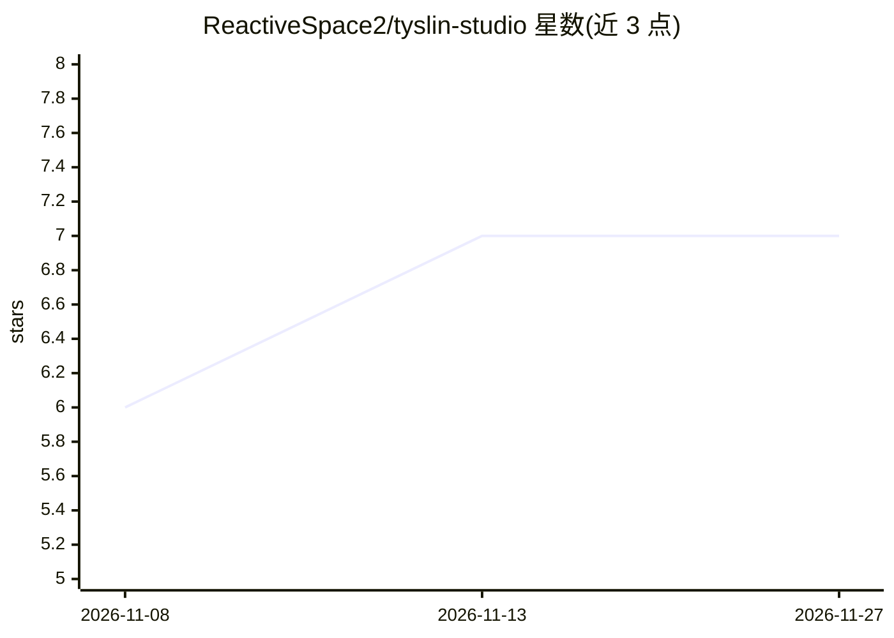

# ReactiveSpace2/tyslin-studio

⭐ 7 · TypeScript · 推送 2026-11-17 · [GitHub](https://github.com/ReactiveSpace2/tyslin-studio) · [官网](https://tyslin.ai) · 个人维护

**AI agent 团队桌面管理面板：Lead 规划任务并派发给多个 CLI agent**

开源 Electron 桌面应用（beta，Linux 测试为主，macOS/Windows 未签名），用于组织 AI agent 团队：用户下达任务后由 Lead 制定计划，派发给运行在 Claude Code、Codex 或 Gemini CLI 上的 worker，通过 Agent Client Protocol 驱动，适配器由应用经 npm 自动下载更新。提供 10 个团队模板、任务线程、逐条 diff 审批、团队预算、Markdown 记忆、Telegram/Slack 通知与 GitHub/Linear/Stripe/MCP 连接器。凭据用用户自己的 API key 或 CLI 登录态。

## 筛选速览

| 维度 | 判定 | 备注 |
|---|---|---|
| AI 角色 | `ai-ecosystem` | LLM/agent 周边工具 |
| 许可风险 | `none` | — |
| 部署形态 | `desktop` | 安装包/桌面程序 |
| 模型依赖 | local-ok | 支持本地模型 |
| 硬件要求 | — | 无带数字的原话,不猜 |
| 安装摩擦 | `low` | 无编译、无系统依赖或容器化 |
| 成熟度 | `idea` | |

## 能力要点

- Lead 规划-派发-汇报的多 agent 协作流程，逐卡片审批与预算控制
- 适配器经 ACP 驱动 Claude Code、Codex、Gemini CLI，npm 自动安装更新
- 每个文件变更为可接受/退回的 diff，支持 Telegram/Slack 远程通知
- GitHub、Linear、Stripe 及 MCP Registry 的连接器集成

## 适用场景

- 用一组 agent 团队完成软件项目的规划、开发与测试
- 在统一面板审批 AI agent 的每一步文件改动
- 营销/SEO 等非编码任务交给预置团队模板执行

## 场景标签

`多智能体` `编码 Agent` · 领域:Agent 开发

## 证据(README 行号)

> L5:  Tyslin Studio is a free, open-source desktop app for AI agent teams: start a project and put teams of agents to wor
> L11: You give a team a task. Its Lead plans the work and hands it to the team's agents on Claude Code, Codex or Gemini C
> L80: Workers run on Claude Code, Codex or Gemini CLI, driven over the Agent Client Protocol. **Tyslin downloads them its

## 星数曲线

2026-11-08 6 → 2026-11-27 7（+1）

---
*卡片 v1 · prompt 1.4 · 生成 2026-11-20 · 置信度 mid · 依据 README sha `dea1eea4ed19` · [字段定义](../../DATASET.md)*
