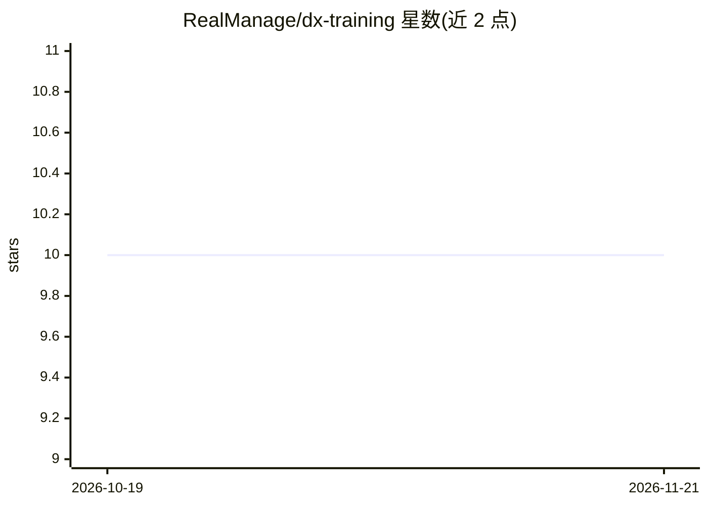

# RealManage/dx-training

⭐ 10 · HTML · NOASSERTION · 推送 2026-10-30 · [GitHub](https://github.com/RealManage/dx-training) · 组织维护

**面向工程师的 AI 辅助开发培训课程仓库（Claude Code、BDD、持续交付）**

RealManage 维护的开发者体验培训仓库，包含四门课程：9 周的 AI 101: Claude Code（从安装到 TDD、自定义技能与插件、自动化模式）、BDD 101（Gherkin 语法与 Three Amigos）、持续交付 101（基于 AWS 的 GitLab CI + SAM 流水线、trunk-based 开发与回滚）、以及处于 Draft 状态的 Datadog 排障课程（含 Claude + Datadog MCP 调查演示）。通过 git clone 获取课程材料，各课程 README 附前置要求与每周课程表。

## 筛选速览

| 维度 | 判定 | 备注 |
|---|---|---|
| AI 角色 | `ai-knowledge` | 知识聚合/清单类 |
| 许可风险 | `none` | NOASSERTION |
| 部署形态 | `None` |  |
| 模型依赖 | — | README 未给出锁定关系 |
| 硬件要求 | — | 无带数字的原话,不猜 |
| 安装摩擦 | `low` | 无编译、无系统依赖或容器化 |
| 成熟度 | — | 结构信号不足 |

## 能力要点

- AI 101: Claude Code 课程覆盖 TDD、自定义技能与插件、自动化模式，含开发/QA/PM/支持四条路线
- 排障课程演示 Claude Code 与 Datadog MCP server 执行同样的调查并核验其结果
- 课程仓库提供 GitHub（外部）与 GitLab（内部）两种克隆途径
- 列出待上线课程 AI 102：Agent Teams、多 agent 编排等主题

## 适用场景

- 带团队学习如何用 Claude Code 进行测试驱动开发
- 为工程团队组织 BDD 与协作式规范工作坊
- 参考真实案例学习迁移到 AWS 持续交付流水线

## 场景标签

`教程课程` · 领域:学习与行业

## 证据(README 行号)

> L3: Welcome to the RealManage DX Training repository — technical training courses designed to elevate engineering capabi
> L7: ### AI 101: Claude Code

## 星数曲线

2026-10-19 10 → 2026-11-21 10（+0）

---
*卡片 v1 · prompt 1.4 · 生成 2026-11-20 · 置信度 high · 依据 README sha `03aa70a31ac8` · [字段定义](../../DATASET.md)*
