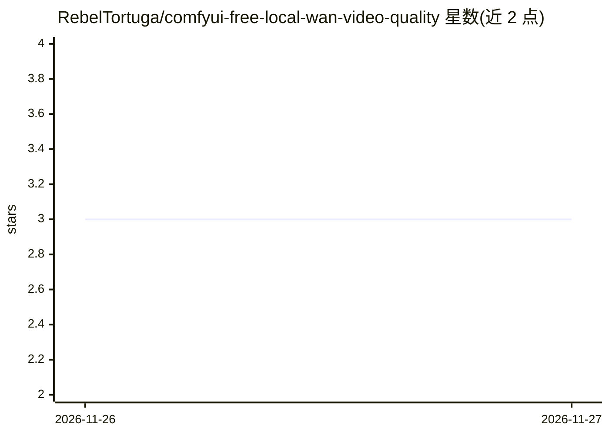

# RebelTortuga/comfyui-free-local-wan-video-quality

⭐ 3 · Python · MIT · 推送 2026-11-02 · [GitHub](https://github.com/RebelTortuga/comfyui-free-local-wan-video-quality) · [官网](https://rebeltortuga.github.io/projects/comfyui-free-local-wan-video-quality.html) · 个人维护

**本地免费 ComfyUI 工作流：静态图生成 Wan 2.2 视频**

一个面向本地 ComfyUI 的 Wan 2.2 图生视频工作流包：加载参考图与运动提示词，按 480×768、201 帧、24 fps 设置生成视频，输出保存在 ComfyUI 输出目录。工作流 JSON 以 MIT 许可发布，模型权重与自定义节点需另行安装；包含 Clean Slate 控制器、本地保存的提示词历史节点及可选验证脚本。面向使用 Windows/ Stability Matrix 环境的 ComfyUI 用户，无付费 API 或订阅，效果依赖自身 GPU 与内存配置，硬件最低要求未经验证。

## 筛选速览

| 维度 | 判定 | 备注 |
|---|---|---|
| AI 角色 | `ai-native` | 本体是模型或模型工具 |
| 许可风险 | `permissive` | MIT |
| 部署形态 | `None` |  |
| 模型依赖 | — | README 未给出锁定关系 |
| 硬件要求 | — | 无带数字的原话,不猜 |
| 安装摩擦 | `low` | 无编译、无系统依赖或容器化 |
| 成熟度 | — | 结构信号不足 |

## 能力要点

- 图生视频：480×768、201 帧、24 fps，提供 49 帧/16 步快速试用设置
- Clean Slate 控制器一键清除图像与正/负提示词，历史本地保存
- 附 validate_workflow.py 结构校验脚本与 SOURCE.json 溯源记录
- 工作流 JSON 以 MIT 许可免费发布，无需 API key

## 适用场景

- 把静态图变成约 8 秒的运动视频
- 在本地 GPU 上离线生成 AI 视频
- 作为自制视频工作流的起点模板

## 场景标签

`视频生成` · 领域:内容生成

## 证据(README 行号)

> L13: Wan 2.2 image-to-video generation at 480 × 768, with 201 frames at 24 fps.
> L19: **Price: $0 for this workflow.** It runs image/video inference on your own computer with locally installed models. 

## 星数曲线

2026-11-26 3 → 2026-11-27 3（+0）

---
*卡片 v1 · prompt 1.4 · 生成 2026-11-26 · 置信度 high · 依据 README sha `36d921c6efae` · [字段定义](../../DATASET.md)*
