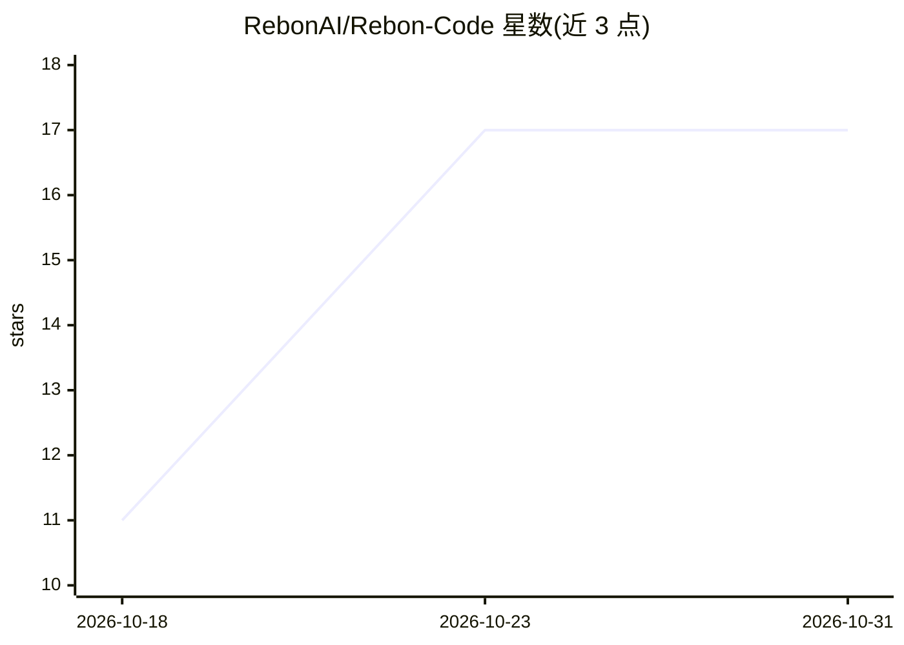

# RebonAI/Rebon-Code

⭐ 17 · Rust · Apache-2.0 · 推送 2026-10-29 · [GitHub](https://github.com/RebonAI/Rebon-Code) · [官网](https://reboncode.ai) · 组织维护 · 中文 README

**终端里的 LLM 编码 agent CLI：工具循环、会话与权限管理**

Rust 编写的命令行 agent 客户端，通过 agent 循环驱动 LLM 在终端中执行编码等任务：内置 Bash/文件读写/Grep/Glob 等工具、后台子 agent、持久记忆层、细粒度权限（四种模式含 auto）与沙箱配置。支持 Anthropic、OpenAI 提供商，OAuth 或 API key 登录。提供本地 TUI、编辑器接入的 ACP JSON-RPC 模式、SSH 远程会话与 MCP 工具。npm 全局安装，随平台原生二进制分发；桌面/移动/Web 端不在本仓库。无遥测。

## 筛选速览

| 维度 | 判定 | 备注 |
|---|---|---|
| AI 角色 | `ai-native` | 本体是模型或模型工具 |
| 许可风险 | `permissive` | Apache-2.0 |
| 部署形态 | `desktop` | 安装包/桌面程序 |
| 模型依赖 | — | README 未给出锁定关系 |
| 硬件要求 | — | 无带数字的原话,不猜 |
| 安装摩擦 | `low` | 无编译、无系统依赖或容器化 |
| 成熟度 | — | 结构信号不足 |

## 能力要点

- TUI 内完整 agent 工具循环（shell、文件、任务、Team、MCP）
- 四种权限模式（default/plan/accept edits/auto）与沙箱及违规上报
- 后台子 agent 与持久记忆层（skills/agents/memory）
- ACP JSON-RPC 模式可供编辑器驱动，SSH 远程会话在远端执行

## 适用场景

- 在终端里让 LLM 读写文件并跑命令来完成编码任务
- 通过编辑器 ACP 协议调用同一 agent 会话
- 在远程主机上执行 agent 任务、本地保留 UI 与记录

## 场景标签

`编码 Agent` · 领域:编码与开发

## 证据(README 行号)

> L5:  An agent CLI for coding and more — a terminal harness that drives an
> L118: - **Providers** — Anthropic, OpenAI, and OpenAI-Responses, with streaming,

## 星数曲线

2026-10-18 11 → 2026-10-31 17（+6）

---
*卡片 v1 · prompt 1.4 · 生成 2026-10-30 · 置信度 high · 依据 README sha `f68259110b88` · [字段定义](../../DATASET.md)*
