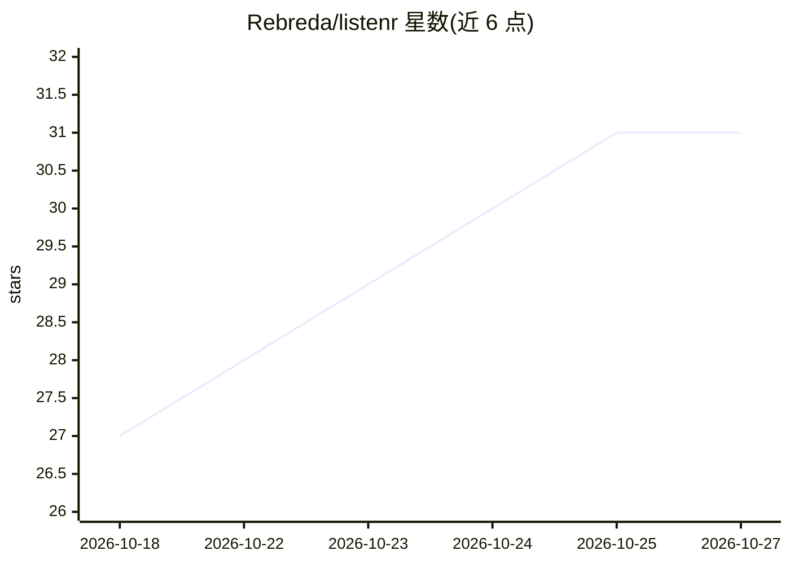

# Rebreda/listenr

⭐ 31 · Python · MPL-2.0 · 推送 2026-10-24 · [GitHub](https://github.com/Rebreda/listenr) · 个人维护

**本地录音采集语音数据并微调 Whisper/Moonshine 语音模型**

本地语音数据采集与 ASR 模型微调工具：通过麦克风流式录音（~85ms 分块，16kHz），经 Lemonade 的 /realtime WebSocket 运行 Whisper.cpp 转录，并由本地 LLM 自动修正标点、语法与同音词，生成更高质量的训练语料。保存为 .wav 片段与 manifest.jsonl，一键构建 train/dev/test 数据集划分，支持用 LoRA 微调 openai/whisper-* 或 moonshine-* 模型（AMD/NVIDIA GPU，经 Podman），merge 命令将适配器合并为可用 transformers 加载的独立模型。全部数据留在本机。核心安装覆盖录音、转录与数据集构建，微调等功能在 extras 中。

## 筛选速览

| 维度 | 判定 | 备注 |
|---|---|---|
| AI 角色 | `ai-native` | 本体是模型或模型工具 |
| 许可风险 | `permissive` | MPL-2.0 |
| 部署形态 | `library` | 以包/库形式分发 |
| 模型依赖 | — | README 未给出锁定关系 |
| 硬件要求 | — | 无带数字的原话,不猜 |
| 安装摩擦 | `medium` | 含编译或系统依赖之一 |
| 成熟度 | — | 结构信号不足 |

## 能力要点

- 麦克风流式录音 + Whisper.cpp 实时转录（Lemonade WebSocket）
- 本地 LLM 自动修正标点/语法/同音词，提升语料质量
- 一条命令构建 HuggingFace 格式的 train/dev/test 数据集
- LoRA 微调 Whisper 或 Moonshine，merge 生成无 PEFT 依赖的独立模型

## 适用场景

- 采集含领域词汇的自然语音用于训练自己的 ASR 模型
- 将录音整理为带修正文本的语音数据集
- 在 AMD/NVIDIA GPU 上本地微调并部署 Whisper/Moonshine
- 导入 Mozilla Data Collective 或 Hugging Face 数据集混合训练

## 场景标签

`语音识别` `微调` · 领域:感知与多模态

## 证据(README 行号)

> L5: **Build better speech-to-text and ASR models entirely on your machine.**
> L7: Record your voice. Clean it up with local AI. Fine-tune Whisper or Moonshine. Deploy something that's actually yours
> L86: **Recording & transcription** - Listenr streams your microphone to Lemonade's `/realtime` WebSocket in ~85 ms chunk

## 星数曲线

2026-10-18 27 → 2026-10-27 31（+4）

---
*卡片 v1 · prompt 1.4 · 生成 2026-10-26 · 置信度 high · 依据 README sha `6c0520415ecd` · [字段定义](../../DATASET.md)*
