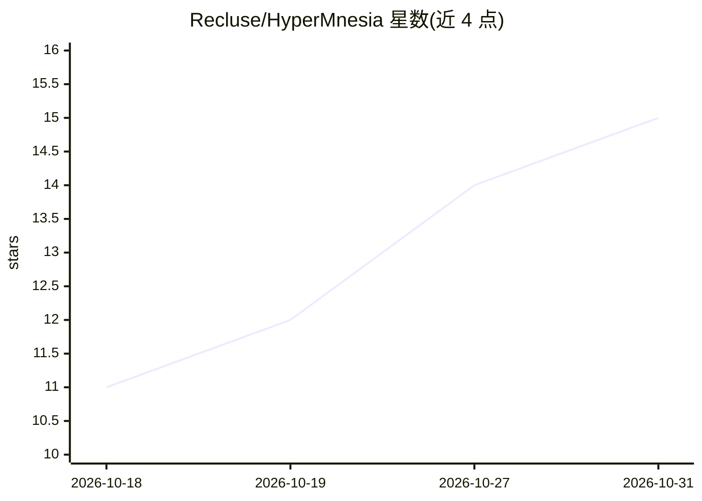

# Recluse/HyperMnesia

⭐ 15 · Python · MIT · 推送 2026-10-30 · [GitHub](https://github.com/Recluse/HyperMnesia) · 个人维护

**给 AI 编码 agent 的自托管长期记忆：文档 RAG + 个人记忆**

基于 Postgres+pgvector 的自托管存储，为 AI 编码 agent（Claude Code 或任意 MCP 客户端）提供两部分能力：一是架构记忆，将仓库文档做混合检索（bge-m3 稠密 + tsvector 词法，RRF 融合，可选 cross-encoder 重排），并用手工维护的组件→约束映射在编辑前注入适用不变量；二是个人记忆，双时间线、supersede-not-overwrite、带证据溯源图，派生结论需人工审核。嵌入可用 Ollama 或 TEI 本地模型，无云端依赖，可在笔记本、单机或 Kubernetes 运行。检索与记忆以 MCP 工具暴露，自动注入/捕获则依赖 Claude Code hooks。只索引文档与记忆，不索引代码符号。

## 筛选速览

| 维度 | 判定 | 备注 |
|---|---|---|
| AI 角色 | `ai-ecosystem` | LLM/agent 周边工具 |
| 许可风险 | `permissive` | MIT |
| 部署形态 | `self-host` | docker 或自建部署 |
| 模型依赖 | local-ok | 支持本地模型 |
| 硬件要求 | — | 无带数字的原话,不猜 |
| 安装摩擦 | `low` | 无编译、无系统依赖或容器化 |
| 成熟度 | — | 结构信号不足 |

## 能力要点

- 文件路径→组件→约束的确定性映射，编辑前经 PreToolUse hook 注入不变量
- 混合检索：bge-m3 稠密 + tsvector 词法，RRF 融合 + 可选 bge-reranker-v2-m3 重排
- 个人记忆双时间线、证据溯源图、派生结论人工审核、行级安全控制
- 不确定时弃答而非返回最近匹配；./hm doctor 诊断索引/嵌入/漂移等故障

## 适用场景

- 让编码 agent 在编辑文件前自动获得适用的架构规则
- 跨会话保留我对项目的偏好、决策及其理由，不必每次重述
- 用检索替代固定说明文件以降低 token 消耗
- 为任意 MCP 客户端提供文档与记忆查询工具

## 场景标签

`Agent 记忆` `RAG` · 领域:Agent 开发

## 证据(README 行号)

> L8: *The opposite of amnesia* (Greek *hypermnesia* — abnormally complete recall). Self-hosted long-term
> L22: **Two interfaces, and they are not the same thing.** Search, the map and memory are exposed as
> L24: an edit, memory recalled per prompt, sessions captured — is a set of **Claude Code hooks**.

## 星数曲线

2026-10-18 11 → 2026-10-31 15（+4）

---
*卡片 v1 · prompt 1.4 · 生成 2026-10-31 · 置信度 high · 依据 README sha `fe3bb1c39b2b` · [字段定义](../../DATASET.md)*
