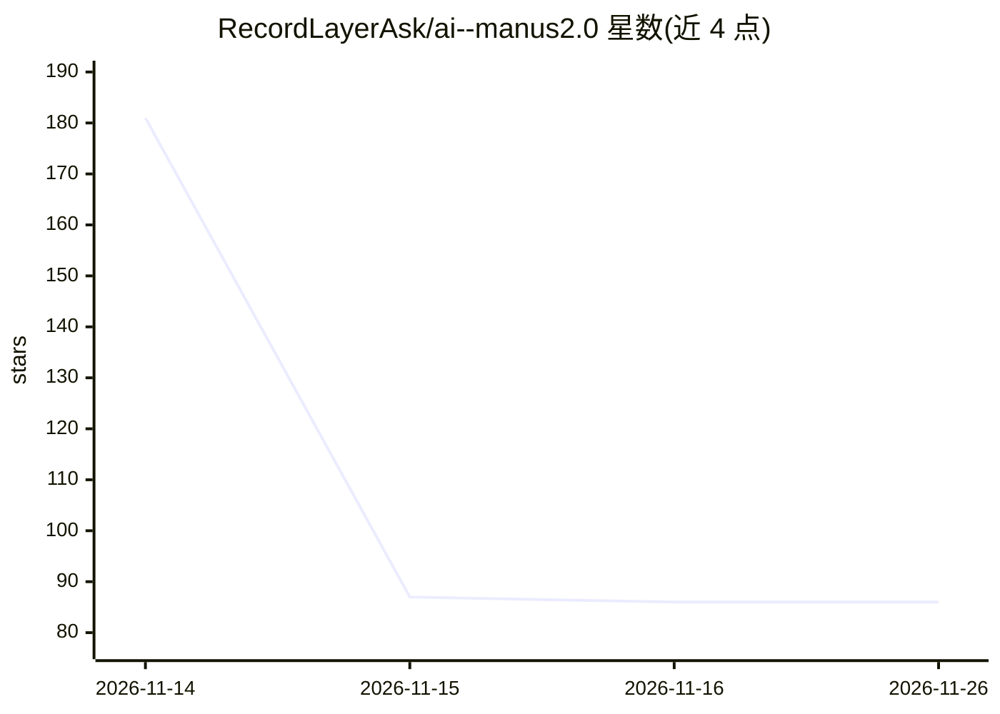

# RecordLayerAsk/ai--manus2.0

⭐ 86 · Apache-2.0 · 推送 2026-11-15 · [GitHub](https://github.com/RecordLayerAsk/ai--manus2.0) · 个人维护

**面向个人用户的自主 AI Agent：代跑代码与操控浏览器**

自称 Manus 的自主 AI Agent，定位为个人助手：代替用户编写并执行脚本、打开网页、填写表单、跨代码与浏览器完成多步骤任务，并在会话间保持工作流模式。README 面向学生、远程工作者等非开发者用户，声明适用于学习研究、家庭项目与轻量办公。提供硬件兼容性表（最低 4GB 内存、双核 CPU）与上手步骤说明，但未给出任何安装命令、下载链接或源码结构；'Download Manus' 与 PROMO2026 字样无对应说明。

## 筛选速览

| 维度 | 判定 | 备注 |
|---|---|---|
| AI 角色 | `ai-native` | 本体是模型或模型工具 |
| 许可风险 | `permissive` | Apache-2.0 |
| 部署形态 | `None` |  |
| 模型依赖 | — | README 未给出锁定关系 |
| 硬件要求 | — | 无带数字的原话,不猜 |
| 安装摩擦 | `low` | 无编译、无系统依赖或容器化 |
| 成熟度 | — | 结构信号不足 |

## 能力要点

- 自主执行代码与浏览器操作的多步骤任务
- 代码与浏览器操作可在同一流程中衔接
- 跨会话记住工作流模式并可重复应用

## 适用场景

- 让 Agent 代为查网页、填表、汇总信息
- 学生整理研究笔记、跑小型计算脚本
- 远程工作者从多页面收集数据准备摘要

## 场景标签

`AI 助手` `浏览器自动化` `编码 Agent` · 领域:效率与自动化

## 证据(README 行号)

> L10: - **Autonomous Code Execution:** Manus AI agent runs code on its own to complete tasks, so you can focus on decisio
> L18: Manus is an autonomous AI agent designed to run code and control a browser on your behalf. Instead of acting like a

## 星数曲线

2026-11-14 181 → 2026-11-26 86（-95）

---
*卡片 v1 · prompt 1.4 · 生成 2026-11-17 · 置信度 low · 依据 README sha `637da4fbcded` · [字段定义](../../DATASET.md)*
