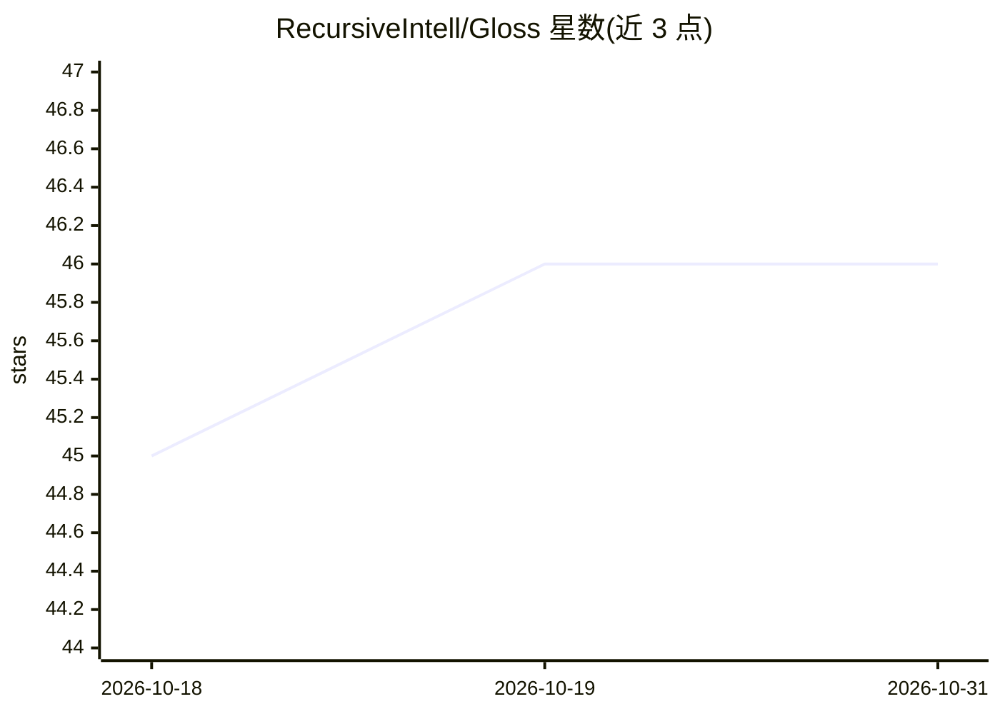

# RecursiveIntell/Gloss

⭐ 46 · Rust · AGPL-3.0 · 推送 2026-10-28 · [GitHub](https://github.com/RecursiveIntell/Gloss) · 组织维护

**本地优先的源引用研究与对话桌面笔记本（Tauri 2）**

基于 Rust/Tauri 2 与 React 的本地优先桌面笔记本：在隔离的笔记本目录中导入文件/URL/YouTube 字幕/音视频等来源，通过 SQLite FTS5/BM25 与本地 HNSW 稠密检索做源引用对话，支持 all/selected/none 检索范围与引用回执；提供 Ollama、llama.cpp、OpenAI、Anthropic 适配器。另有 Studio 结构化输出、.glosspkg 便携归档与诊断修复。当前仅源码分发，无标签化二进制发布，Linux x86_64 为维护目标。

## 筛选速览

| 维度 | 判定 | 备注 |
|---|---|---|
| AI 角色 | `ai-native` | 本体是模型或模型工具 |
| 许可风险 | `viral` | AGPL-3.0 |
| 部署形态 | `None` |  |
| 模型依赖 | local-ok | 支持本地模型 |
| 硬件要求 | — | 无带数字的原话,不猜 |
| 安装摩擦 | `high` | 编译与系统依赖俱全 |
| 成熟度 | `idea` | |

## 能力要点

- SQLite FTS5/BM25 与本地 HNSW 稠密检索加倒数排序融合
- Ollama/llama.cpp/OpenAI/Anthropic 源级 provider 适配器
- 含 SHA-256 校验的 .glosspkg.tar.gz 笔记本归档与恢复
- Studio 结构化输出（报告/摘要/闪卡/测验等）含确定性回退

## 适用场景

- 在本地导入资料并做带引用溯源的对话式研究
- 按选中来源限定检索范围进行问答
- 将笔记本打包归档并在本地迁移恢复

## 场景标签

`知识库管理` `文档问答` `科研工具` · 领域:知识与检索

## 证据(README 行号)

> L5: > A local-first desktop notebook for source-grounded research and chat.
> L128: - Source-level provider adapters exist for Ollama, llama.cpp, OpenAI, and Anthropic. Automated transport contracts
> L131: - SQLite FTS5/BM25 and local HNSW dense retrieval with reciprocal-rank fusion.

## 星数曲线

2026-10-18 45 → 2026-10-31 46（+1）

---
*卡片 v1 · prompt 1.4 · 生成 2026-10-25 · 置信度 high · 依据 README sha `165d8a2ff4a0` · [字段定义](../../DATASET.md)*
