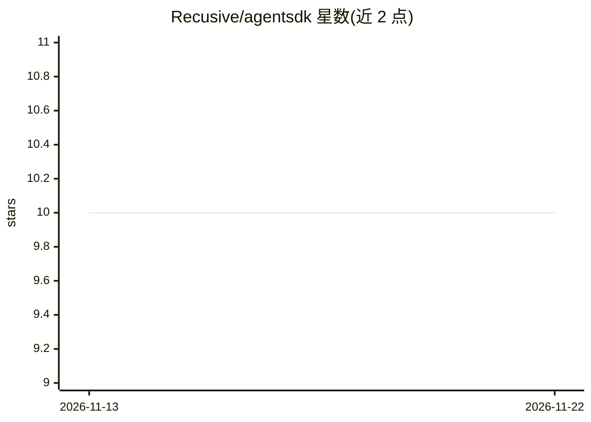

# Recusive/agentsdk

⭐ 10 · TypeScript · MIT · 推送 2026-01-24 · [GitHub](https://github.com/Recusive/agentsdk) · [官网](https://www.agentsdk.build/) · 组织维护

**面向 AI agent 开发者的开源 Rust 后端 SDK**

从 OpenCode 重写而来的开源 AI agent 后端 SDK，以 Rust crate 工作区形式提供，负责 LLM 供应商通信、工具执行（bash、文件操作、代码分析）、会话管理与流式事件处理，并计划包含 OAuth 认证、LSP 与 MCP 客户端。重写动机为降低内存占用、启动时间与分发体积。当前处于逐步迁移阶段，部分 crate 已完成、多数仍在计划中；衍生自该 SDK 的 Orbit 桌面环境为闭源商业产品。

## 筛选速览

| 维度 | 判定 | 备注 |
|---|---|---|
| AI 角色 | `ai-ecosystem` | LLM/agent 周边工具 |
| 许可风险 | `permissive` | MIT |
| 部署形态 | `None` |  |
| 模型依赖 | locked-api |  |
| 硬件要求 | — | 无带数字的原话,不猜 |
| 安装摩擦 | `low` | 无编译、无系统依赖或容器化 |
| 成熟度 | `idea` | |

## 能力要点

- 处理多 LLM 供应商通信（Anthropic、OpenAI、Google、AWS Bedrock、本地模型）
- 支持工具执行、会话管理与实时流式事件
- 提供开发用测试 CLI 与 crate 迁移工作流文档
- 单一静态二进制分发，无需 Node/Bun 运行时

## 适用场景

- 为 AI coding agent 构建后端服务
- 在桌面应用中集成 agent 工具执行与会话管理
- 为 IDE 类产品提供 Rust 实现的 agent 基础设施

## 场景标签

`Agent 框架` `编码 Agent` · 领域:Agent 开发

## 证据(README 行号)

> L29: **Orbit Rust SDK** is an open-source AI agent backend that handles:
> L31: - LLM provider communication (Anthropic, OpenAI, Google, AWS Bedrock, local models)
> L37: This SDK is derived from OpenCode and is being rewritten in Rust. It's **free and open source** for the community t

## 星数曲线

2026-11-13 10 → 2026-11-22 10（+0）

---
*卡片 v1 · prompt 1.4 · 生成 2026-11-20 · 置信度 high · 依据 README sha `cc488192eb8d` · [字段定义](../../DATASET.md)*
