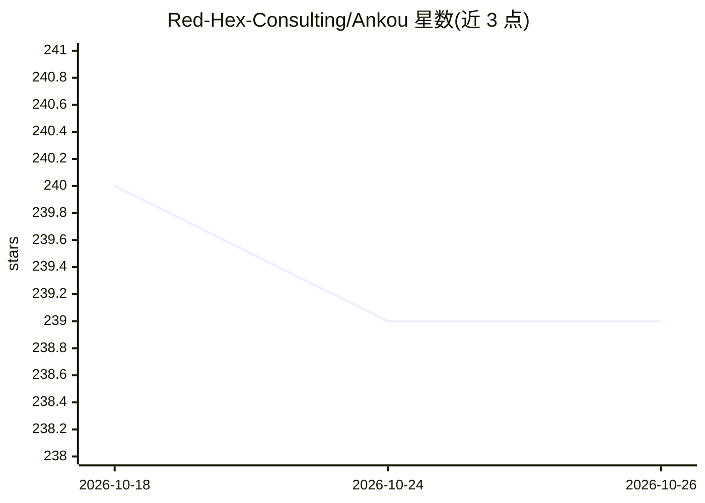

# Red-Hex-Consulting/Ankou

⭐ 239 · TypeScript · BSD-3-Clause · 推送 2026-04-24 · [GitHub](https://github.com/Red-Hex-Consulting/Ankou) · [官网](https://ankou.ai) · 组织维护

**带 AI 助手的模块化 C2 框架，供红队与安全测试人员使用**

模块化命令控制（C2）平台，含 Go 服务器（GraphQL/WebSocket/JWT/HMAC）、多协议 Ghost Relay 中继（HTTPS/HTTP3-QUIC/SSH/SMB）、5 个参考植入体（geist/phantasm/anomaly/shade/wraith）与 Electron 桌面客户端。AI 部分为人机协同助手面板与 Poly Engine 二进制多样化引擎，二者通过 OpenAI 兼容 API 接入任意本地或自托管端点（Ollama/LM Studio/OpenWebUI 等），默认 base URL 指向 localhost:11434。README 声明仅限道德研究、安全测试与防御用途。需安装 Go 并从源码运行，quickstart.py 初始化密钥。

## 筛选速览

| 维度 | 判定 | 备注 |
|---|---|---|
| AI 角色 | `ai-enhanced` | 去掉 AI 部分产品仍成立 |
| 许可风险 | `permissive` | BSD-3-Clause |
| 部署形态 | `desktop` | 安装包/桌面程序 |
| 模型依赖 | local-ok | 支持本地模型 |
| 硬件要求 | — | 无带数字的原话,不猜 |
| 安装摩擦 | `low` | 无编译、无系统依赖或容器化 |
| 成熟度 | — | 结构信号不足 |

## 能力要点

- AI 助手读取全量命令输出历史，可总结、起草后续命令并支持点击执行（<cmdankou> 标签）
- Poly Engine 重写植入体源码结构，生成功能等价但签名不同的二进制
- 多传输协议中继（HTTPS/HTTP3-QUIC/SSH/SMB/WebSocket），按请求体识别 agent 类型
- Automations 面板沉淀可复用 playbook（分诊/提权/横向移动）

## 适用场景

- 红队搭建可扩展的多协议 C2 基础设施并定制专属 agent
- 用本地 LLM 分析目标遥测数据、筛噪并建议下一步命令
- 在自托管基础设施内完成授权渗透测试任务管理

## 场景标签

`网络安全` · 领域:学习与行业

## 证据(README 行号)

> L13: Ankou is a modern, modular command-and-control (C2) platform designed to let operators move fast without sacrificin
> L39: - The client's **AI Operations** panel talks to any OpenAI-compatible endpoint so all target data can stay on hosts
> L78: The AI assistant and Poly Engine both speak the OpenAI API. You can point Ankou at any OpenAI-compatible backend:

## 星数曲线

2026-10-18 240 → 2026-10-26 239（-1）

---
*卡片 v1 · prompt 1.4 · 生成 2026-10-22 · 置信度 high · 依据 README sha `304313f6ecc1` · [字段定义](../../DATASET.md)*
