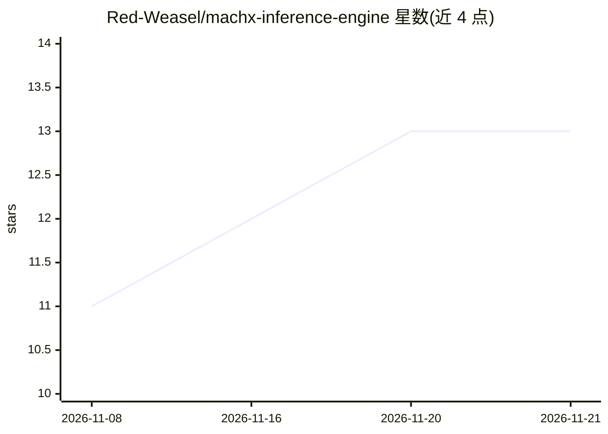

# Red-Weasel/machx-inference-engine

⭐ 13 · C++ · Apache-2.0 · 推送 2026-11-20 · [GitHub](https://github.com/Red-Weasel/machx-inference-engine) · 个人维护

**面向 Intel Arc GPU 的本地 LLM 推理引擎**

用 C++/SYCL 编写的本地推理引擎，在 Arc Pro B70 卡上构建与调优：提供 XMX(DPAS) 内核、K-quant/Q8_0 量化加载、多卡层拆分（--gpus N）与 OpenAI 兼容服务器（ie serve），覆盖 Qwen3.8、DeepSeek-V4.1、MiMo-V2.6、GLM-5.3 与 LTX-2.5 文生视频模型。支持 GGUF 格式（含 llama.cpp 布局的 MTP 头与超参读取）、prompt 缓存与投机解码。README 以版本日志形式记录各版本变更与双卡/四卡实测吞吐数字。

## 筛选速览

| 维度 | 判定 | 备注 |
|---|---|---|
| AI 角色 | `ai-ecosystem` | LLM/agent 周边工具 |
| 许可风险 | `permissive` | Apache-2.0 |
| 部署形态 | `None` |  |
| 模型依赖 | locked-api |  |
| 硬件要求 | `gpu-24g` | |
| 安装摩擦 | `medium` | 含编译或系统依赖之一 |
| 成熟度 | — | 结构信号不足 |

## 能力要点

- XMX(DPAS) 与整数点积内核支持 Q4_K–Q8_0 量化格式
- --gpus N 层拆分多卡执行，≥3 卡时各阶段并行读取 prompt
- OpenAI 兼容服务器 ie serve 与 LTX-2.5 文生视频
- 专家权重 VRAM/RAM 分层与按会话热度换页

## 适用场景

- 在没有 CUDA 的 Intel Arc 显卡上本地运行量化 LLM
- 用多张 Arc Pro B70 拆分部署大参数 MoE 模型
- 通过 OpenAI 兼容接口把本地模型接入应用
- 在 Arc 上做文本到视频生成

## 场景标签

`推理引擎` `视频生成` · 领域:内容生成

## 证据(README 行号)

> L5: **A C++/SYCL local LLM inference engine for Intel Arc GPUs, built and tuned on two Arc Pro B70 cards: XMX kernels, q
> L38: - **v0.2.42, November 13 — DeepSeek-V4.1's VRAM expert set follows the conversation too:** a hot RAM expert trades 

## 星数曲线

2026-11-08 11 → 2026-11-21 13（+2）

---
*卡片 v1 · prompt 1.4 · 生成 2026-11-18 · 置信度 high · 依据 README sha `21a3bbe9be44` · [字段定义](../../DATASET.md)*
