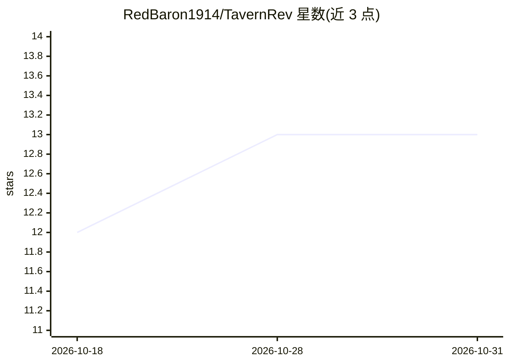

# RedBaron1914/TavernRev

⭐ 13 · TypeScript · NOASSERTION · 推送 2026-10-10 · [GitHub](https://github.com/RedBaron1914/TavernRev) · 个人维护 · 中文 README

**Android/Windows 原生角色扮演聊天客户端，接多种 AI 后端**

基于 Rust/Tauri 构建、面向高级角色扮演（roleplay）的字符聊天客户端，原生支持 Android 与 Windows。功能包括多角色群聊与发言路由、Dropbox/Google Drive 增量云同步、聊天分支与 Swipe 重投、STScript 异步脚本、SillyTavern 格式导入导出与 V2 角色卡。AI 后端支持 Google Gemini、OpenAI 推理模型、AI Horde 及任意 OpenAI 兼容 API；本地 RAG 长期记忆使用 SQLite+ONNX 在 CPU 上本地计算嵌入。目前为 Beta v1.6.3，README 声明存在预期内的 Bug。

## 筛选速览

| 维度 | 判定 | 备注 |
|---|---|---|
| AI 角色 | `ai-native` | 本体是模型或模型工具 |
| 许可风险 | `none` | NOASSERTION |
| 部署形态 | `desktop` | 安装包/桌面程序 |
| 模型依赖 | — | README 未给出锁定关系 |
| 硬件要求 | — | 无带数字的原话,不猜 |
| 安装摩擦 | `low` | 无编译、无系统依赖或容器化 |
| 成熟度 | `idea` | |

## 能力要点

- 多角色群聊：发言路由（提及/轮询/手动）、群场景与静音/话痨度调节
- SQLite+ONNX 纯本地嵌入的长期记忆（RAG），支持多语言嵌入模型
- 接入 Gemini/OpenAI/AI Horde/KoboldCPP 等自定义 OpenAI 兼容后端
- SillyTavern 聊天与预设互导、V2 角色卡（PNG/JSON）支持

## 适用场景

- 在手机和电脑上进行 AI 角色扮演聊天
- 从 SillyTavern 迁移聊天记录与角色卡
- 多角色群聊场景下探索分支剧情
- 本地连接 KoboldCPP 等自建后端进行对话

## 场景标签

`聊天机器人` · 领域:对话与助手

## 证据(README 行号)

> L7: A next-generation, high-performance character chat client designed for speed and compatibility.
> L43: - **Google Gemini 2.5 & 3.0**: Native support for the latest models with **Thinking Level** control (Low/High/Budge
> L44: - **OpenAI (o1/o3)**: Full support for reasoning models via `Reasoning Effort` settings.

## 星数曲线

2026-10-18 12 → 2026-10-31 13（+1）

---
*卡片 v1 · prompt 1.4 · 生成 2026-10-31 · 置信度 high · 依据 README sha `7599e1105fd5` · [字段定义](../../DATASET.md)*
