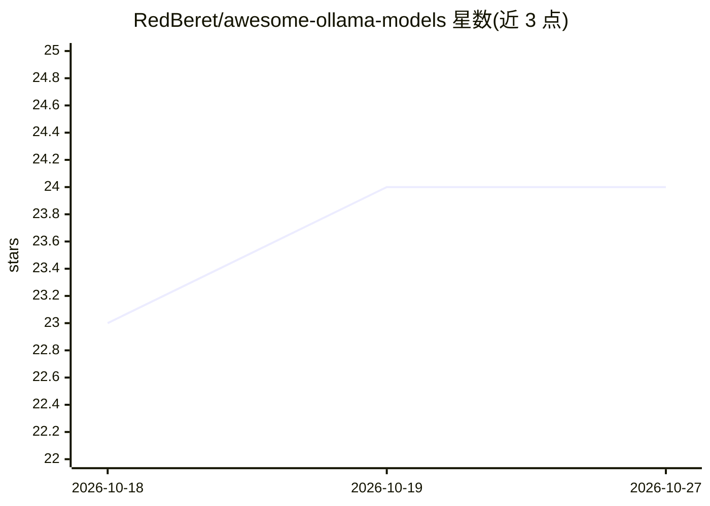

# RedBeret/awesome-ollama-models

⭐ 24 · Python · MIT · 推送 2026-10-15 · [GitHub](https://github.com/RedBeret/awesome-ollama-models) · 组织维护

**Ollama 本地/云端模型策展清单：含定价、选型建议与目录校验**

面向使用 Ollama 的开发者的模型目录（awesome list）：以 2026-10-14 快照收录 18 个云端直连标识及本地示例模型，从 data/models.json 生成对比表格，覆盖上下文长度、输入模态、工具/思考支持；区分本地标签、CLI 云标签与直连 API ID 三种调用方式，整理 Ollama 云定价档位、任务选型起点、API curl 示例、生产可靠性建议，并用 Python 3.12 标准库脚本（catalog.py）做目录校验与生成，附云端目录漂移监测与来源冲突审计。属时点参考，不保证可用性。

## 筛选速览

| 维度 | 判定 | 备注 |
|---|---|---|
| AI 角色 | `ai-knowledge` | 知识聚合/清单类 |
| 许可风险 | `permissive` | MIT |
| 部署形态 | `None` |  |
| 模型依赖 | — | README 未给出锁定关系 |
| 硬件要求 | — | 无带数字的原话,不猜 |
| 安装摩擦 | `low` | 无编译、无系统依赖或容器化 |
| 成熟度 | — | 结构信号不足 |

## 能力要点

- 覆盖本地标签 / CLI 云标签 / 直连 API ID 三种标识命名空间的对照表
- 生成式模型目录（data/models.json）+ 校验/生成/测试脚本
- 按任务（编码/Agent/长文档/推理等）给出编辑性选型起点与验证建议
- 整理 Ollama 云定价档、错误重试与回退等生产可靠性条款

## 适用场景

- 查某模型该用哪个 CLI 标签或直连 API ID
- 按任务类型挑选本地或云端的起点模型
- 了解 Ollama 云免费/付费档位与计费方式

## 场景标签

`精选清单` · 领域:学习与行业

## 证据(README 行号)

> L1: # awesome-ollama-models
> L3: > A sourced guide to Ollama local and cloud models, with generated comparisons and cloud catalog drift monitoring.
> L56: This block is generated from `data/models.json`. Context labels describe the published tag, not a tested effective 

## 星数曲线

2026-10-18 23 → 2026-10-27 24（+1）

---
*卡片 v1 · prompt 1.4 · 生成 2026-10-27 · 置信度 high · 依据 README sha `9376d22660fe` · [字段定义](../../DATASET.md)*
