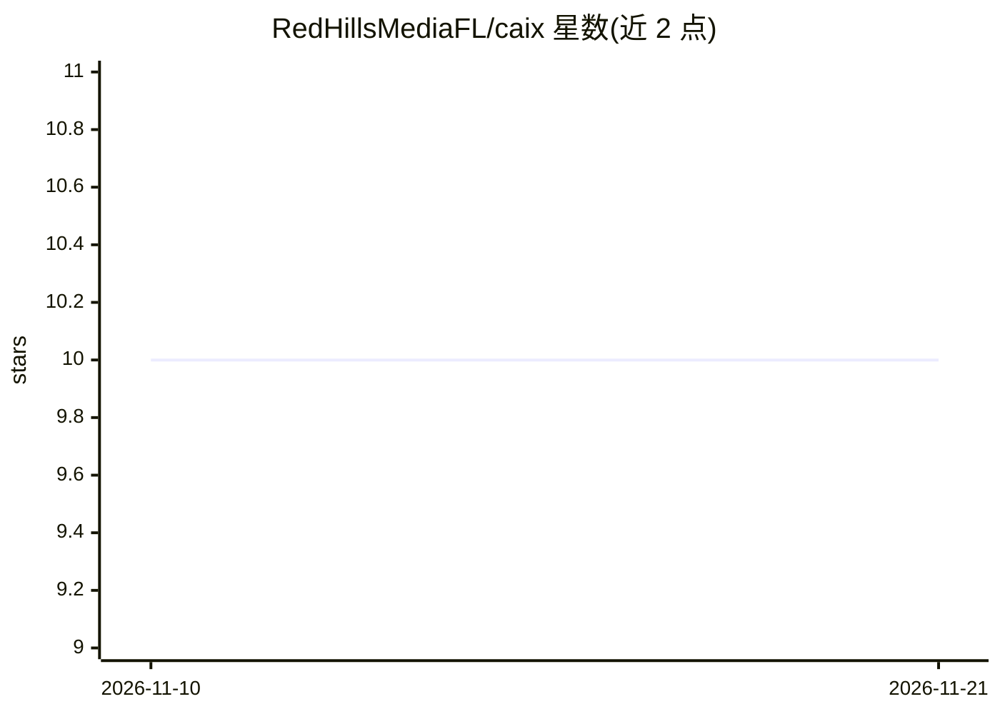

# RedHillsMediaFL/caix

⭐ 10 · Swift · NOASSERTION · 推送 2026-08-17 · [GitHub](https://github.com/RedHillsMediaFL/caix) · [官网](https://huggingface.co/redhillsmediafl) · 组织维护

**为 Apple silicon 用户提供本地 Core AI 推理服务器，兼容 OpenAI/Anthropic API**

caix 是运行在 Apple silicon 上的本地推理服务器：加载 Core AI .aimodel 语言包，在 Neural Engine + GPU 上推理，暴露 OpenAI 兼容 /v1/chat/completions 与 Anthropic 兼容 /v1/messages API，附带 Web 仪表盘、聊天界面（流式、工具、技能、MCP）与终端聊天。支持 MTP/投机解码、多模态 Gemma 4 图文输入、常驻 Whisper 转录端点。限制：依赖 macOS 27 beta 与 Core AI beta 运行时，需匹配 Xcode beta，冷加载需编译 30-60 秒，MTP 路径下低参数模型工具调用不可靠。

## 筛选速览

| 维度 | 判定 | 备注 |
|---|---|---|
| AI 角色 | `ai-ecosystem` | LLM/agent 周边工具 |
| 许可风险 | `none` | NOASSERTION |
| 部署形态 | `None` |  |
| 模型依赖 | — | README 未给出锁定关系 |
| 硬件要求 | — | 无带数字的原话,不猜 |
| 安装摩擦 | `low` | 无编译、无系统依赖或容器化 |
| 成熟度 | `idea` | |

## 能力要点

- OpenAI 与 Anthropic 兼容 API（流式），本地客户端可直接指向服务器
- Web 仪表盘：机器统计、模型加载/卸载/转换/删除、tok/s 用量统计持久化
- MTP/EAGLE 投机解码支持，自动调整 draft 窗口
- 聊天支持工具、技能、MCP 服务器接入；常驻 Whisper large-v2 转录端点

## 适用场景

- 在 Mac 上本地运行 LLM 并以 OpenAI 兼容 API 接入既有客户端
- 通过 Web 聊天界面进行带工具与 MCP 的流式对话
- 为 OpenCode 等编码工具配置本地模型提供方
- 本地部署 Whisper 转录服务

## 场景标签

`推理引擎` `语音识别` · 领域:感知与多模态

## 证据(README 行号)

> L10: Local Core AI inference server for Apple silicon — private, on-device LLMs behind OpenAI- and
> L16: caix serves Core AI `.aimodel` language bundles on Apple silicon (Neural Engine + GPU). It exposes:
> L20: - **OpenAI-compatible** (`/v1/chat/completions`) and **Anthropic-compatible** (`/v1/messages`) APIs.

## 星数曲线

2026-11-10 10 → 2026-11-21 10（+0）

---
*卡片 v1 · prompt 1.4 · 生成 2026-11-20 · 置信度 high · 依据 README sha `0953e6f4cf4f` · [字段定义](../../DATASET.md)*
