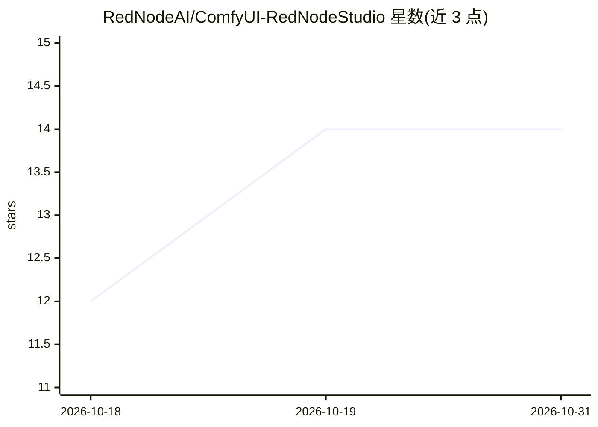

# RedNodeAI/ComfyUI-RedNodeStudio

⭐ 14 · JavaScript · NOASSERTION · 推送 2026-10-16 · [GitHub](https://github.com/RedNodeAI/ComfyUI-RedNodeStudio) · [官网](https://civitai.red/user/RedNodeAI) · 个人维护

**ComfyUI 图像全流程工作室节点包：单面板出图、编辑、上色与后期**

ComfyUI 自定义节点集（62/64 nodes，无 pip 依赖），提供一个分页 Workspace 面板整合图像流水线：模型家族一键配置（Krea 2、Qwen Image 2.1、Z-Image、Anima、SDXL 等）、结构化提示词、Paint 局部重绘、Detailer、22 项后期相机效果、按规则归档保存；Hero Creator 从单张照片生成头像并通过身份编辑将同一人物置入新场景；支持设置 VRAM 上限以在小显存显卡上运行大模型，并提供无线控制面板。安装方式为 Windows 批处理脚本或 ComfyUI Manager / git clone。许可为 PolyForm Noncommercial（非商用）。

## 筛选速览

| 维度 | 判定 | 备注 |
|---|---|---|
| AI 角色 | `ai-ecosystem` | LLM/agent 周边工具 |
| 许可风险 | `none` | NOASSERTION |
| 部署形态 | `None` |  |
| 模型依赖 | — | README 未给出锁定关系 |
| 硬件要求 | — | 无带数字的原话,不猜 |
| 安装摩擦 | `low` | 无编译、无系统依赖或容器化 |
| 成熟度 | — | 结构信号不足 |

## 能力要点

- 单面板 Workspace 覆盖提示词→渲染→细节→后期→保存全流程
- 一键配置多模型家族（Krea 2 / Qwen Image 2.1 / Z-Image / Anima / SDXL 等）
- VRAM 上限机制，大模型可在小显存 GPU 上运行
- Hero Creator 单照片生成头像并做 Krea 2 身份编辑

## 适用场景

- 在 ComfyUI 中用单面板完成出图、编辑、局部重绘与后期
- 小显存显卡上运行大模型图像流水线
- 用一张照片让同一人物出现在不同场景

## 场景标签

`图像生成` · 领域:内容生成

## 证据(README 行号)

> L14: **64 nodes · No pip dependencies · Every model, every purpose**
> L43: git clone https://github.com/RedNodeAI/ComfyUI-RedNodeStudio.git ComfyUI/custom_nodes/ComfyUI-RedNodeStudio

## 星数曲线

2026-10-18 12 → 2026-10-31 14（+2）

---
*卡片 v1 · prompt 1.4 · 生成 2026-10-31 · 置信度 high · 依据 README sha `e097fd805301` · [字段定义](../../DATASET.md)*
