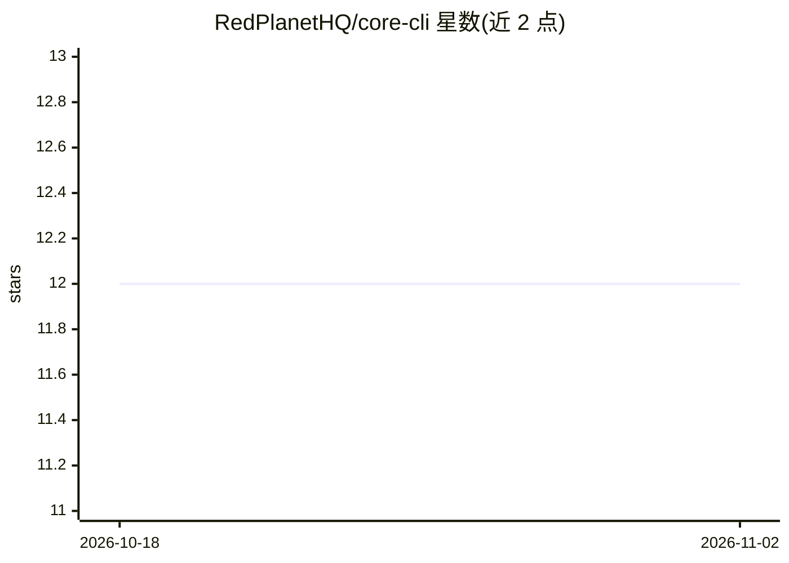

# RedPlanetHQ/core-cli

⭐ 12 · TypeScript · NOASSERTION · 推送 2026-01-05 · [GitHub](https://github.com/RedPlanetHQ/core-cli) · 组织维护

**带持久记忆的终端 AI 任务管理器**

基于 Node 的终端任务管理 CLI，通过自然语言对话管理任务，并将实现工作委托给 AI 编码代理（Claude Code、Cursor、Aider、Codex CLI），代理在隔离 tmux 会话与独立 git worktree 中并行运行。其 CORE 服务作为时序知识图谱提供跨会话持久记忆，记录任务、决策与偏好，并可经 MCP 连接 GitHub、Linear、Slack、Gmail 等集成。使用需 LLM API Key 与 CORE 账号，功能依赖 tmux 与 git。

## 筛选速览

| 维度 | 判定 | 备注 |
|---|---|---|
| AI 角色 | `ai-native` | 本体是模型或模型工具 |
| 许可风险 | `none` | NOASSERTION |
| 部署形态 | `library` | 以包/库形式分发 |
| 模型依赖 | locked-api |  |
| 硬件要求 | — | 无带数字的原话,不猜 |
| 安装摩擦 | `low` | 无编译、无系统依赖或容器化 |
| 成熟度 | — | 结构信号不足 |

## 能力要点

- 自然语言创建/同步任务，@sync 例程扫描集成应用并给出优先级建议
- 任务委托给 Claude Code/Cursor/Aider/Codex CLI，在 tmux + git worktree 中并行隔离运行
- CORE 时序知识图谱持久记忆任务、对话与决策，对话时自动检索相关上下文
- 经 MCP 连接 GitHub/Linear/Slack/Gmail，可读取并代为执行操作

## 适用场景

- 在终端里用自然语言统一管理 GitHub/Linear/Slack 等来源的任务
- 把实现任务委托给 AI 编码代理并行执行并随时切换会话
- 借助持久记忆让 AI 助手保持项目上下文与历史决策

## 场景标签

`编码 Agent` `AI 助手` `Agent 记忆` · 领域:Agent 开发

## 证据(README 行号)

> L6: A terminal-first task manager powered by AI, with persistent memory across sessions. Built on CORE - so it actually 
> L53: Launches your preferred coding agent (Claude Code, Cursor, Aider) in an isolated environment:
> L93: CORE is your second brain - a temporal knowledge graph that remembers what you're working on, what decisions you ma

## 星数曲线

2026-10-18 12 → 2026-11-02 12（+0）

---
*卡片 v1 · prompt 1.4 · 生成 2026-11-01 · 置信度 mid · 依据 README sha `9388a883fe41` · [字段定义](../../DATASET.md)*
