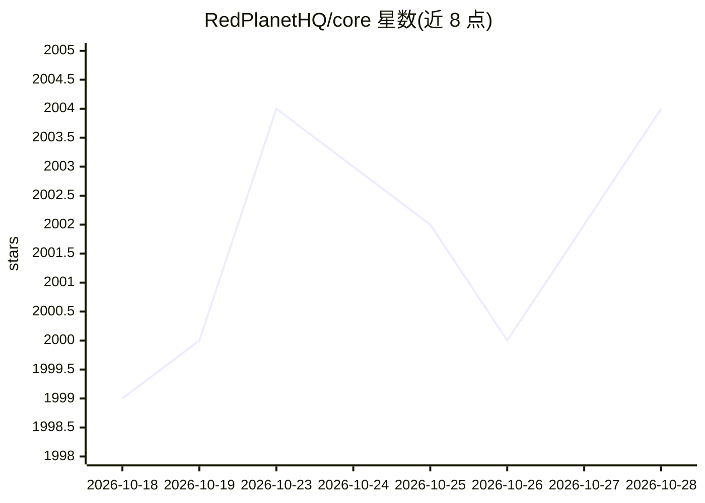

# RedPlanetHQ/core

⭐ 2,005 · TypeScript · NOASSERTION · 推送 2026-09-07 · [GitHub](https://github.com/RedPlanetHQ/core) · [官网](https://getcore.me) · 组织维护 · 中文 README

**自托管的个人 AI 助理系统：记忆+任务+语音+编码代理**

面向个人用户的开源自托管 AI OS：将邮件、会议、GitHub、Slack 等索引为时序知识图谱作为持久记忆，以任务为单位做规划并经人工批准后执行；可调用 Claude Code 或 Codex 编码会话（本机或 Docker/Railway 运行、完成后开 PR）、驱动内置隔离浏览器、执行终端命令。支持语音触发（Mac Ctrl+Option）、Scratchpad 待办捕获，并可通过 WhatsApp/Slack/Telegram 消息下达任务。经由 MCP 提供 50+ 应用一键集成，通过 npm CLI 安装，依赖 Docker，需 4 vCPU / 8GB RAM。可复用已有 Claude/Codex 订阅而非单独 API key。

## 筛选速览

| 维度 | 判定 | 备注 |
|---|---|---|
| AI 角色 | `ai-native` | 本体是模型或模型工具 |
| 许可风险 | `viral` | NOASSERTION |
| 部署形态 | `self-host` | docker 或自建部署 |
| 模型依赖 | locked-api |  |
| 硬件要求 | — | 无带数字的原话,不猜 |
| 安装摩擦 | `low` | 无编译、无系统依赖或容器化 |
| 成熟度 | — | 结构信号不足 |

## 能力要点

- 邮件/会议/GitHub/Slack 等索引为时序知识图谱的持久记忆
- 任务规划+人工批准后执行，可拉起 Claude Code/Codex 会话并开 PR
- 50+ 应用 MCP 集成与 Webhook 触发
- 语音、Scratchpad、WhatsApp/Slack/Telegram 多入口触达

## 适用场景

- 把日常待办和个人上下文交给常驻 AI 助理规划和执行
- 通过消息或语音远程指派任务并复用已有 Claude/Codex 订阅
- 让 AI 在隔离浏览器和终端中代为完成工作流

## 场景标签

`AI 助手` `编码 Agent` `工作流自动化` `Agent 记忆` · 领域:Agent 开发

## 证据(README 行号)

> L61: CORE indexes email, meetings, GitHub, Linear, Slack and every assistant conversation into a temporal knowledge grap
> L86: CORE spins up Claude Code or Codex sessions with the full task context, runs them on your machine or in Docker/Rail

## 星数曲线

2026-10-18 1,999 → 2026-10-28 2,004（+5）

---
*卡片 v1 · prompt 1.4 · 生成 2026-10-21 · 置信度 high · 依据 README sha `f6ec8134b6c5` · [字段定义](../../DATASET.md)*
