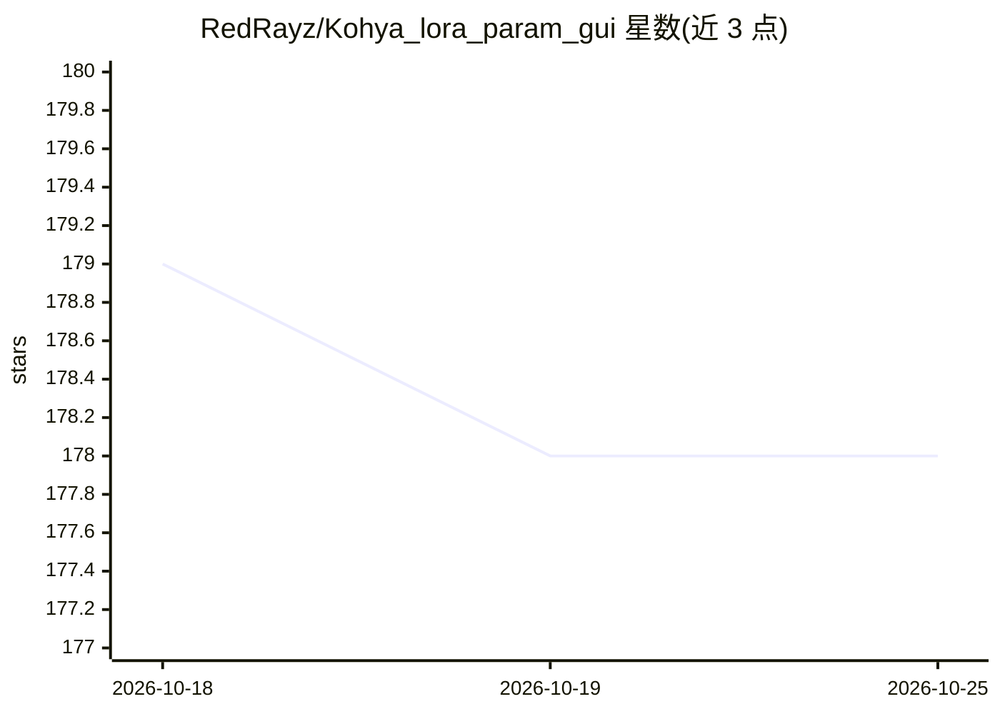

# RedRayz/Kohya_lora_param_gui

⭐ 178 · C# · MIT · 推送 2026-10-24 · [GitHub](https://github.com/RedRayz/Kohya_lora_param_gui) · 个人维护

**Windows 桌面 GUI：为 kohya sd-scripts 设定 LoRA 训练参数**

面向 Windows 的桌面应用，用于在 GUI 上配置 kohya-ss/sd-scripts 的 LoRA 训练参数并生成命令行传给 sd-scripts。使用 .NET 而非 Python/gradio，应用体积小、启动快。支持训练参数预设以 XML 保存/读取、启动 tensorboard、记忆上次设置、多 LoRA 批量训练、Dim 重采样，以及 sd-scripts 的安装与更新。要求 Windows 10/11 x86-64、.NET Desktop Runtime 9.0、Python、Git 与 Turing 以后 NVIDIA GPU；bmaltais 的 kohya_ss 环境不支持。

## 筛选速览

| 维度 | 判定 | 备注 |
|---|---|---|
| AI 角色 | `ai-ecosystem` | LLM/agent 周边工具 |
| 许可风险 | `permissive` | MIT |
| 部署形态 | `None` |  |
| 模型依赖 | — | README 未给出锁定关系 |
| 硬件要求 | — | 无带数字的原话,不猜 |
| 安装摩擦 | `medium` | 含编译或系统依赖之一 |
| 成熟度 | — | 结构信号不足 |

## 能力要点

- GUI 配置 LoRA 训练参数并生成命令行传给 sd-scripts
- 参数预设 XML 保存/读取与多 LoRA 批量训练
- 内置 sd-scripts 的简易安装器与更新功能
- 非 gradio 的 .NET 桌面应用，体积小启动快

## 适用场景

- 不想手写命令行，用 GUI 为 sd-scripts 配置 LoRA 训练
- 保存和复用训练参数预设
- 一次批量训练多个 LoRA

## 场景标签

`微调` · 领域:训练与推理

## 证据(README 行号)

> L5: https://github.com/kohya-ss/sd-scripts のLoRA学習用のパラメータをGUI上で設定してコマンドラインに渡すWindows専用のGUIです。
> L29: このGUIはコマンドを生成し、sd-scriptsに渡しているだけであり直接の関係はありません。sd-scripts開発者にGUIについて問い合わせる行為はご遠慮ください。

## 星数曲线

2026-10-18 179 → 2026-10-25 178（-1）

---
*卡片 v1 · prompt 1.4 · 生成 2026-10-22 · 置信度 high · 依据 README sha `d446e9b30128` · [字段定义](../../DATASET.md)*
