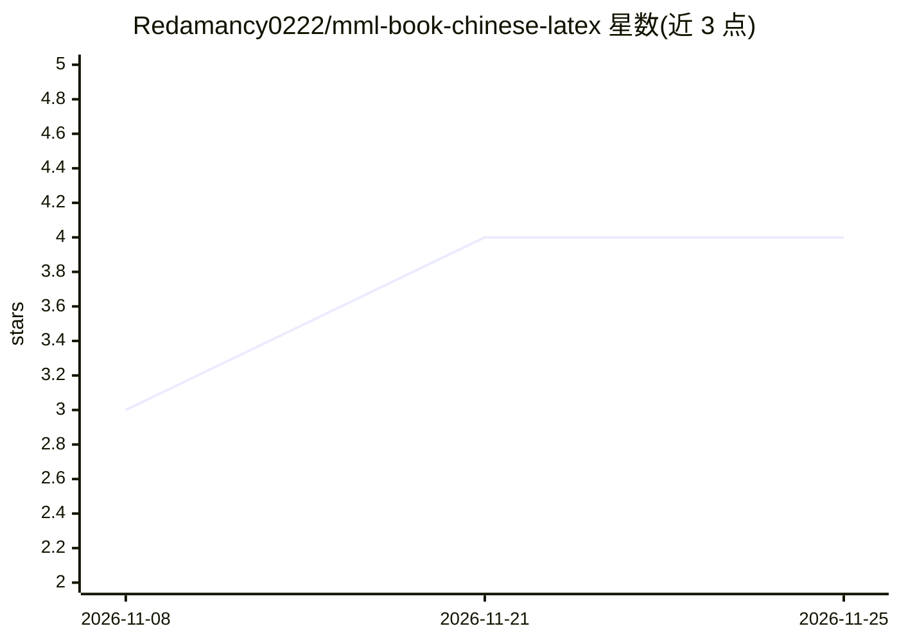

# Redamancy0222/mml-book-chinese-latex

⭐ 4 · TeX · NOASSERTION · 推送 2026-10-12 · [GitHub](https://github.com/Redamancy0222/mml-book-chinese-latex) · [官网](https://github.com/dxxzst/mml-book-chinese) · 个人维护 · 中文 README

**为读者提供《机器学习中的数学》中文版 LaTeX 工程与 408 页 PDF**

将社区中文 Markdown 译本（dxxzst/mml-book-chinese）转换为完整 LaTeX 工程并编译为单一 PDF 的构建仓库，由 DeepSeek 完成格式转换。保留原书公式编号、把交叉引用改为可点击跳转、处理中文排版字体、按成品 PDF 反向生成真实页码术语索引。提供成品 PDF 下载，也可通过 Python 脚本与 XeLaTeX 自行编译复现，附验收脚本检查编译错误与未解析引用。译文与脚本均以 MIT License 发布。

## 筛选速览

| 维度 | 判定 | 备注 |
|---|---|---|
| AI 角色 | `ai-knowledge` | 知识聚合/清单类 |
| 许可风险 | `none` | NOASSERTION |
| 部署形态 | `None` |  |
| 模型依赖 | — | README 未给出锁定关系 |
| 硬件要求 | — | 无带数字的原话,不猜 |
| 安装摩擦 | `low` | 无编译、无系统依赖或容器化 |
| 成熟度 | — | 结构信号不足 |

## 能力要点

- 408 页成品 PDF：144 幅内嵌插图、1,203 个编号公式、459 条术语索引
- 保留原书 \tag{} 公式编号，交叉引用改为可点击的 \eqref/\ref
- 迭代编译至页码与索引收敛，附 verify.py 验收脚本
- 提供一条命令 python make_book.py 完整复现

## 适用场景

- 下载阅读《机器学习中的数学》中文版完整 PDF
- 自行编译复现本书 LaTeX 工程
- 反馈译文的误译、术语不统一或公式笔误问题

## 场景标签

`教程课程` · 领域:学习与行业

## 证据(README 行号)

> L3: > **Mathematics for Machine Learning（中文翻译版）** 的完整 LaTeX 工程与编译成品 PDF。
> L45: 这不是一本讲「怎么调库」的书。它的出发点是：**很多人想深入理解机器学习，却卡在数学上。**

## 星数曲线

2026-11-08 3 → 2026-11-25 4（+1）

---
*卡片 v1 · prompt 1.4 · 生成 2026-11-21 · 置信度 high · 依据 README sha `5707f44791cd` · [字段定义](../../DATASET.md)*
