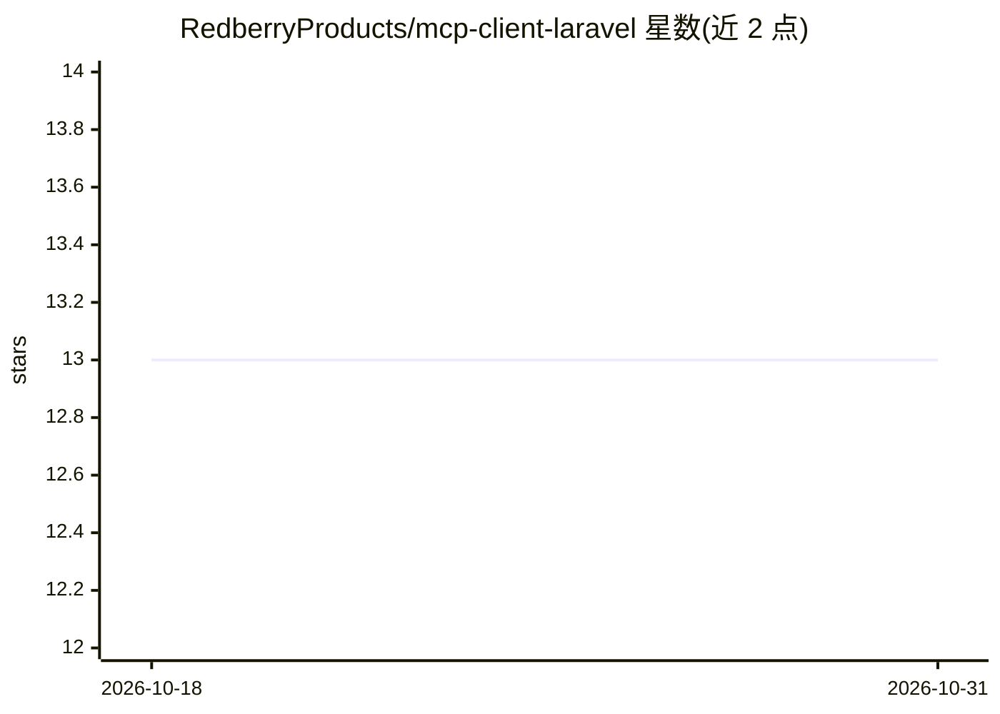

# RedberryProducts/mcp-client-laravel

⭐ 13 · PHP · MIT · 推送 2026-10-26 · [GitHub](https://github.com/RedberryProducts/mcp-client-laravel) · 组织维护

**Laravel 应用的 MCP 客户端包：连接 MCP 服务器调用工具与资源**

Redberry 维护的 Laravel 原生 Model Context Protocol 客户端 Composer 包，通过 JSON-RPC 2.0 与 MCP 服务器通信，支持 Streamable HTTP 与 STDIO 两种传输：HTTP 首次请求执行 initialize 握手并持有会话 ID，404 会话失效时自动重握手重试一次；STDIO 以子进程方式按需懒启动并复用。提供单一 facade 用于列出/调用工具、读取资源，并支持 SSE 流式事件回调。传输层可自定义扩展。面向在 Laravel 应用中接入 MCP 工具生态的开发者，由 LarAgent 等框架使用。限制：STDIO 传输在 php artisan serve 下不可用，需 Octane、队列 worker、Sail 或 Valet 运行。

## 筛选速览

| 维度 | 判定 | 备注 |
|---|---|---|
| AI 角色 | `ai-ecosystem` | LLM/agent 周边工具 |
| 许可风险 | `permissive` | MIT |
| 部署形态 | `library` | 以包/库形式分发 |
| 模型依赖 | — | README 未给出锁定关系 |
| 硬件要求 | — | 无带数字的原话,不猜 |
| 安装摩擦 | `low` | 无编译、无系统依赖或容器化 |
| 成熟度 | — | 结构信号不足 |

## 能力要点

- Streamable HTTP 与 STDIO 双传输，SSE 流式事件回调
- 会话失效 404 自动重握手并重试
- 单一 facade 支持多服务器并发连接、工具过滤与资源读取
- 实现 Transporter 接口即可自定义传输层

## 适用场景

- 在 Laravel 应用中调用 GitHub 等 MCP 服务器的工具
- 为 AI agent 功能接入 MCP 工具与资源生态
- 在本地子进程方式运行 MCP 服务器并交互

## 场景标签

`Agent 框架` · 领域:Agent 开发

## 证据(README 行号)

> L8: A Laravel client for the Model Context Protocol. It speaks JSON-RPC 2.0 over both Streamable HTTP (`2025-03-26`) and
> L75: $github = MCPClient::connect('github');

## 星数曲线

2026-10-18 13 → 2026-10-31 13（+0）

---
*卡片 v1 · prompt 1.4 · 生成 2026-10-31 · 置信度 mid · 依据 README sha `258a96838a61` · [字段定义](../../DATASET.md)*
