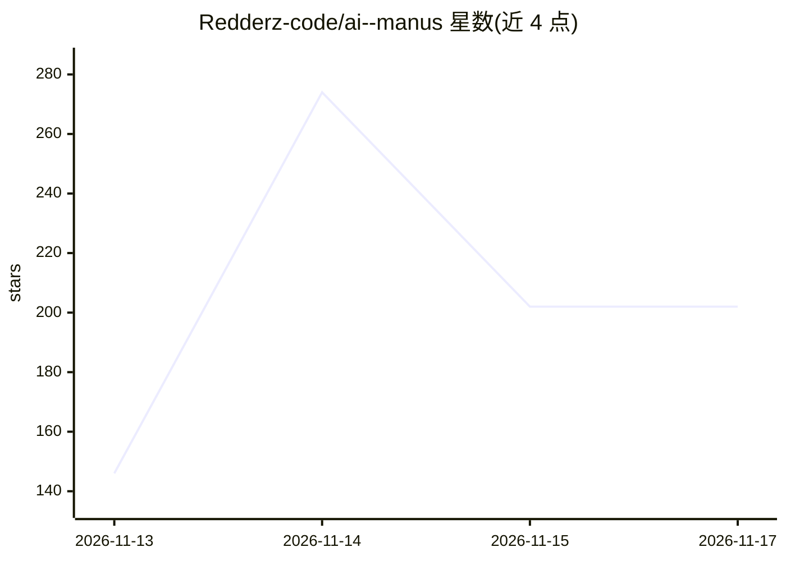

# Redderz-code/ai--manus

⭐ 202 · Apache-2.0 · 推送 2026-11-15 · [GitHub](https://github.com/Redderz-code/ai--manus) · 个人维护

**自主 AI Agent：代用户执行代码与控制浏览器完成多步任务**

面向家庭、学习与轻量办公场景的自主 AI Agent 系统，宣称可在沙箱环境中运行代码、控制浏览器完成导航、填表、信息收集等多步任务，并以后台个人助手形式响应。README 描述了任务自动化与跨会话一致性行为，给出兼容性参考（双核 CPU、4GB 内存起步）与配置步骤说明，但未提供任何安装命令、源码结构或接入模型的具体方式，文档为营销式描述。

## 筛选速览

| 维度 | 判定 | 备注 |
|---|---|---|
| AI 角色 | `ai-native` | 本体是模型或模型工具 |
| 许可风险 | `permissive` | Apache-2.0 |
| 部署形态 | `None` |  |
| 模型依赖 | — | README 未给出锁定关系 |
| 硬件要求 | — | 无带数字的原话,不猜 |
| 安装摩擦 | `low` | 无编译、无系统依赖或容器化 |
| 成熟度 | — | 结构信号不足 |

## 能力要点

- 自主执行代码与脚本（Manus code automation）
- 浏览器控制：导航网页、填写表单、收集信息
- 支持脚本与浏览器动作衔接的多步任务
- 按沙箱环境运行各类工具与操作

## 适用场景

- 让代理代为整理研究资料、运行小脚本
- 自动检查网页更新、填写重复表单
- 远程技术支持中重排诊断步骤与检查系统页面

## 场景标签

`AI 助手` `浏览器自动化` · 领域:效率与自动化

## 证据(README 行号)

> L10: - **Autonomous Code Execution:** Manus AI agent runs code on its own to complete tasks, so you can focus on decisio
> L18: Manus is an autonomous AI agent designed to run code and control a browser on your behalf. Instead of acting like a

## 星数曲线

2026-11-13 146 → 2026-11-17 202（+56）

---
*卡片 v1 · prompt 1.4 · 生成 2026-11-17 · 置信度 low · 依据 README sha `fbfd5e977bf4` · [字段定义](../../DATASET.md)*
