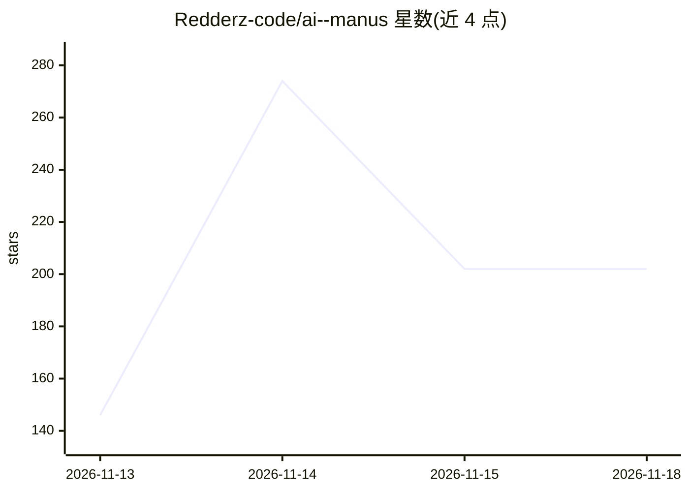

# Redderz-code/ai--manus

⭐ 202 · Apache-2.0 · 推送 2026-11-17 · [GitHub](https://github.com/Redderz-code/ai--manus) · 个人维护

**面向日常小任务的自主体 AI 代理：自行写码并控制浏览器**

Manus 定位为自主 AI 代理，宣称可代表用户编写并执行脚本、控制浏览器（导航页面、填写表单、采集信息），并以个人助手形式在后台执行多步任务。面向学生、远程办公者等非开发者用户，用于学习研究、家庭项目与轻量办公等小规模场景。README 提供系统兼容性表（双核 CPU、4 GB 内存起）与六步上手流程说明，但未给出任何具体安装命令、下载渠道或模型接入方式，也未说明代码实现细节。

## 筛选速览

| 维度 | 判定 | 备注 |
|---|---|---|
| AI 角色 | `ai-native` | 本体是模型或模型工具 |
| 许可风险 | `permissive` | Apache-2.0 |
| 部署形态 | `None` |  |
| 模型依赖 | — | README 未给出锁定关系 |
| 硬件要求 | — | 无带数字的原话,不猜 |
| 安装摩擦 | `low` | 无编译、无系统依赖或容器化 |
| 成熟度 | — | 结构信号不足 |

## 能力要点

- 宣称支持自主编写并执行代码
- 宣称支持浏览器控制（导航、填表、信息采集）
- 覆盖多步任务自动执行，脚本与浏览器动作可在同一流程衔接
- README 提供系统兼容性表与上手/维护步骤说明

## 适用场景

- 让代理代为完成重复性的小脚本与网页查资料工作
- 学习或研究时整理笔记、收集参考资料
- 轻量办公中从多个页面汇总信息准备小结
- 无需编程基础即可委托日常自动化小任务

## 场景标签

`AI 助手` `浏览器自动化` `编码 Agent` · 领域:效率与自动化

## 证据(README 行号)

> L10: - **Autonomous Code Execution:** Manus AI agent runs code on its own to complete tasks, so you can focus on decisio
> L18: Manus is an autonomous AI agent designed to run code and control a browser on your behalf. Instead of acting like a

## 星数曲线

2026-11-13 146 → 2026-11-18 202（+56）

---
*卡片 v1 · prompt 1.4 · 生成 2026-11-18 · 置信度 mid · 依据 README sha `32e48e22fb91` · [字段定义](../../DATASET.md)*
