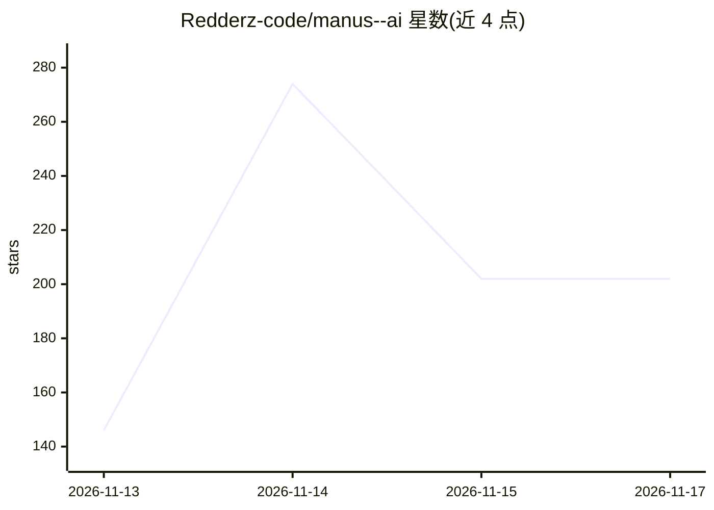

# Redderz-code/manus--ai

⭐ 202 · Apache-2.0 · 推送 2026-11-15 · [GitHub](https://github.com/Redderz-code/manus--ai) · 个人维护

**面向日常任务的自主 AI Agent：自行执行代码与控制浏览器**

README 描述 Manus 为自主 AI agent，可代表用户编写并执行脚本、控制浏览器完成表单填写与信息收集等多步骤任务，定位为面向学习、家庭与轻度办公的个人助理，非企业平台。给出最低/推荐硬件兼容表（双核 CPU、4GB RAM 起）。README 未提供安装命令、代码结构或接入方式说明，无法从 README 验证实际的模型接入与实现；仓库主题标签提及 Anthropic/OpenAI/React 等，但正文未展开。

## 筛选速览

| 维度 | 判定 | 备注 |
|---|---|---|
| AI 角色 | `ai-native` | 本体是模型或模型工具 |
| 许可风险 | `permissive` | Apache-2.0 |
| 部署形态 | `None` |  |
| 模型依赖 | — | README 未给出锁定关系 |
| 硬件要求 | — | 无带数字的原话,不猜 |
| 安装摩擦 | `low` | 无编译、无系统依赖或容器化 |
| 成熟度 | — | 结构信号不足 |

## 能力要点

- 自主编写并执行代码完成任务
- 浏览器控制：导航、填表、收集信息
- 代码与浏览器操作可在同一任务流中衔接
- 给出最低/推荐硬件兼容表（4GB RAM 起）

## 适用场景

- 让学生整理研究笔记、跑快速计算
- 让 agent 代为浏览多个网页汇总信息
- 自动化重复性的小型日常任务

## 场景标签

`AI 助手` `浏览器自动化` · 领域:效率与自动化

## 证据(README 行号)

> L10: - **Autonomous Code Execution:** Manus AI agent runs code on its own to complete tasks, so you can focus on decisio
> L18: Manus is an autonomous AI agent designed to run code and control a browser on your behalf. Instead of acting like a

## 星数曲线

2026-11-13 146 → 2026-11-17 202（+56）

---
*卡片 v1 · prompt 1.4 · 生成 2026-11-17 · 置信度 low · 依据 README sha `0f78ee3a5dd2` · [字段定义](../../DATASET.md)*
