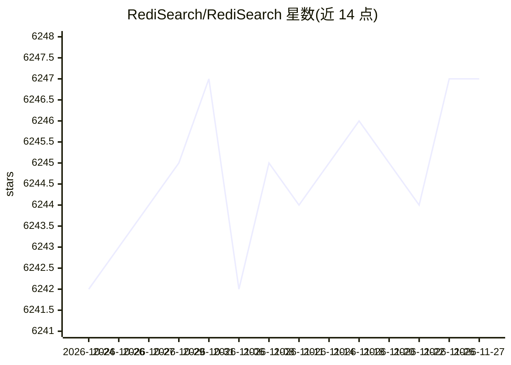

# RediSearch/RediSearch

⭐ 6,247 · Rust · NOASSERTION · 推送 2026-11-26 · [GitHub](https://github.com/RediSearch/RediSearch) · [官网](https://redis.io/docs/latest/develop/ai/search-and-query/) · 组织维护

**Redis 的查询与索引引擎：二级索引、全文与向量搜索**

以 Redis 模块形式提供查询、二级索引与全文检索能力：先在 Redis 数据上声明索引，再用 RediSearch 查询语言检索。采用压缩倒排索引实现快速索引与低内存占用，功能覆盖多字段全文索引、BM25 评分、布尔/模糊/前缀/精确短语查询、多语言词干扩展、中文分词（Friso）、自动补全、数值与地理过滤、聚合引擎及 KNN 向量相似搜索。自 Redis 8 起查询引擎已内置于 Redis，不再发布独立版本；分布式集群版本仅在 Redis Cloud 与 Redis Enterprise 提供。

## 筛选速览

| 维度 | 判定 | 备注 |
|---|---|---|
| AI 角色 | `ai-ecosystem` | LLM/agent 周边工具 |
| 许可风险 | `none` | NOASSERTION |
| 部署形态 | `None` |  |
| 模型依赖 | — | README 未给出锁定关系 |
| 硬件要求 | — | 无带数字的原话,不猜 |
| 安装摩擦 | `low` | 无编译、无系统依赖或容器化 |
| 成熟度 | — | 结构信号不足 |

## 能力要点

- 多字段全文索引与 BM25 评分、字段权重
- KNN、过滤 KNN 与范围查询的向量相似搜索
- 中文分词查询支持（基于 Friso）
- 地理空间索引与 geoshape 索引

## 适用场景

- 给 Redis 中的数据加二级索引并做全文检索
- 对嵌入向量做 KNN 相似度搜索
- 按数值范围和地理位置过滤查询结果
- 对 Redis 数据做多维聚合分析

## 场景标签

`向量数据库` `语义搜索` `数据分析` · 领域:效率与自动化

## 证据(README 行号)

> L28: RediSearch is a Redis module that provides querying, secondary indexing, and full-text search for Redis. To use Red
> L70: * Vector similarity search - KNN, filtered KNN and range query

## 星数曲线

2026-10-24 6,242 → 2026-11-27 6,247（+5）

---
*卡片 v1 · prompt 1.4 · 生成 2026-11-22 · 置信度 high · 依据 README sha `a75eaf3b458c` · [字段定义](../../DATASET.md)*
