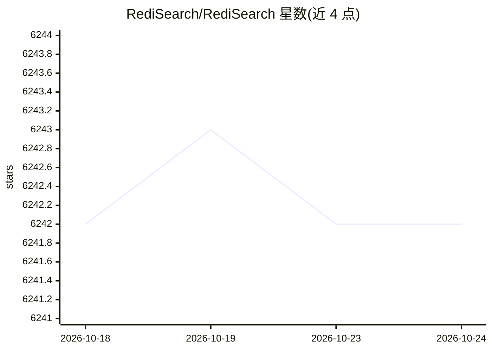

# RediSearch/RediSearch

⭐ 6,242 · Rust · NOASSERTION · 推送 2026-10-24 · [GitHub](https://github.com/RediSearch/RediSearch) · [官网](https://redis.io/docs/latest/develop/ai/search-and-query/) · 组织维护

**Redis 查询与索引引擎：全文检索、向量相似度与聚合**

作为 Redis 模块运行的查询与索引引擎，在 Redis 哈希数据上声明索引后，通过专用查询语言执行二级索引、全文检索、布尔与模糊查询、地理与数值过滤、聚合及向量相似度搜索（KNN、过滤 KNN、范围查询），采用压缩倒排索引，支持 Friso 中文分词。分布式集群版随 Redis Cloud 与 Redis Enterprise Software 提供。自 Redis 8 起并入 Redis Query Engine，不再单独发布独立版本；许可为 RSALv2/SSPLv1/AGPLv3 三选一。

## 筛选速览

| 维度 | 判定 | 备注 |
|---|---|---|
| AI 角色 | `ai-ecosystem` | LLM/agent 周边工具 |
| 许可风险 | `none` | NOASSERTION |
| 部署形态 | `None` |  |
| 模型依赖 | — | README 未给出锁定关系 |
| 硬件要求 | — | 无带数字的原话,不猜 |
| 安装摩擦 | `low` | 无编译、无系统依赖或容器化 |
| 成熟度 | — | 结构信号不足 |

## 能力要点

- 压缩倒排索引实现全文检索，BM25 默认排序
- 向量相似度搜索：KNN、过滤 KNN 与范围查询
- 支持中文分词与查询（Friso）、多语言词干化（Snowball）
- 分布式集群版可扩展至数百服务器的数十亿文档

## 适用场景

- 在 Redis 数据上建立二级索引并执行全文与布尔查询
- 为应用提供向量相似度检索（KNN/范围查询）
- 对文档做地理、数值过滤与聚合分析

## 场景标签

`向量数据库` · 领域:知识与检索

## 证据(README 行号)

> L27: RediSearch is a Redis module that provides querying, secondary indexing, and full-text search for Redis. To use Red
> L44: * [Vector search] (https://redis.io/docs/latest/develop/interact/search-and-query/query/vector-search/)
> L69: * Vector similarity search - KNN, filtered KNN and range query

## 星数曲线

2026-10-18 6,242 → 2026-10-24 6,242（+0）

---
*卡片 v1 · prompt 1.4 · 生成 2026-10-20 · 置信度 high · 依据 README sha `4b72554fa996` · [字段定义](../../DATASET.md)*
