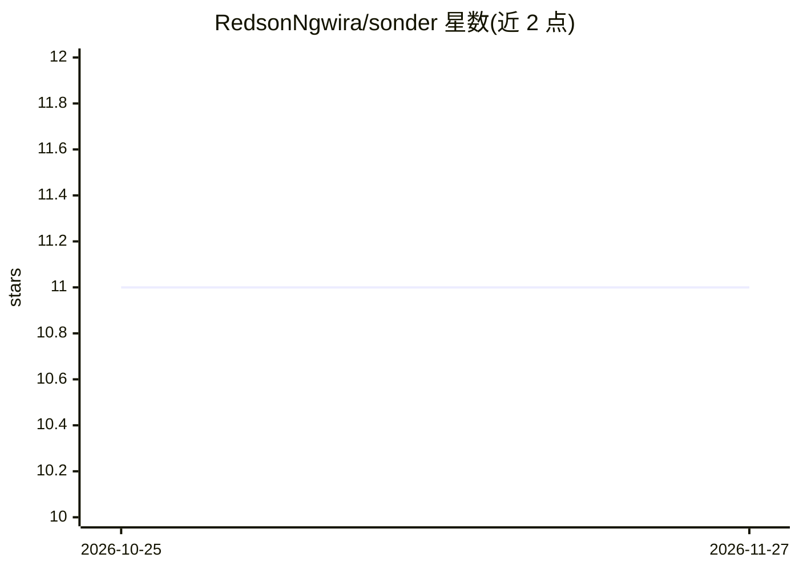

# RedsonNgwira/sonder

⭐ 11 · Python · NOASSERTION · 推送 2026-03-18 · [GitHub](https://github.com/RedsonNgwira/sonder) · 个人维护 · 中文 README

**自托管社交模拟引擎：AI 代理在场景中自主互动**

Sonder 是一个自托管的社会模拟引擎：用户用文字描述一个场景，引擎生成具有各自背景、积怨与说话风格的 AI 代理，代理之间无需用户输入即可自主对话。代理以 .md 文件定义，支持热重载编辑；提供私聊耳语系统、场景氛围追踪和可查询全部代理内部状态的旁白模式；代理行为通过 DuckDuckGo 检索心理学研究作为依据。支持浏览器 TTS 朗读与多种语音插件。以 FastAPI + WebSocket 服务运行，通过 git clone 源码安装，支持 Linux/macOS/Android (Termux)。README 提醒不得未经同意公开分享真实人物的模拟内容。

## 筛选速览

| 维度 | 判定 | 备注 |
|---|---|---|
| AI 角色 | `ai-native` | 本体是模型或模型工具 |
| 许可风险 | `none` | NOASSERTION |
| 部署形态 | `library` | 以包/库形式分发 |
| 模型依赖 | local-ok | 支持本地模型 |
| 硬件要求 | — | 无带数字的原话,不猜 |
| 安装摩擦 | `low` | 无编译、无系统依赖或容器化 |
| 成熟度 | — | 结构信号不足 |

## 能力要点

- 代理以 .md 文件定义，修改后下一 tick 生效、无需重启
- 支持耳语私聊、氛围追踪与旁白模式（可查询代理内部状态）
- 多种免费推理通道：Cerebras/Groq/Gemini/OpenRouter/Qwen OAuth/本地 Ollama
- 全本地自托管，世界数据为可版本控制的纯文本 .md

## 适用场景

- 观察 AI 代理在给定场景中的自主群聊互动
- 通过旁白模式追问场景中角色的想法与关系
- 在自己设备上离线运行代理模拟（Ollama）

## 场景标签

`多智能体` · 领域:Agent 开发

## 证据(README 行号)

> L9: Sonder is a self-hosted social simulation engine. You describe a scene. AI agents with distinct personalities, histo
> L31: - **Autonomous simulation** — agents talk to each other without any input from you
> L99: main.py              FastAPI + WebSocket server

## 星数曲线

2026-10-25 11 → 2026-11-27 11（+0）

---
*卡片 v1 · prompt 1.4 · 生成 2026-11-18 · 置信度 mid · 依据 README sha `062b8c5bd3aa` · [字段定义](../../DATASET.md)*
