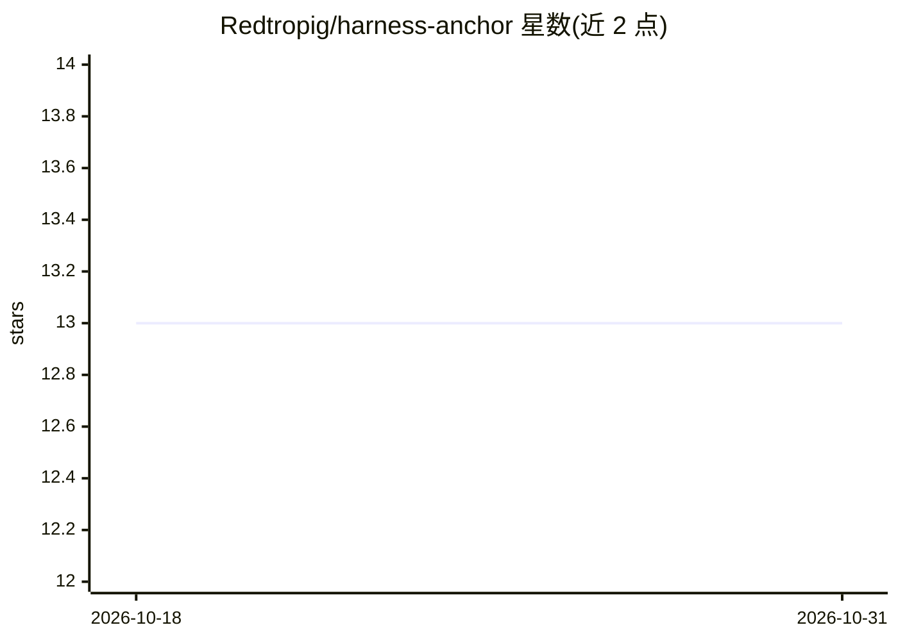

# Redtropig/harness-anchor

⭐ 13 · Shell · MIT · 推送 2026-07-31 · [GitHub](https://github.com/Redtropig/harness-anchor) · 个人维护

**Claude Code agent 的 warn-only 运行时状态层，落盘并要求证据**

面向 Claude Code agent 的插件：把功能状态、范围、交接与进度保存到磁盘文件，会话开始时注入回上下文，使其在 compaction 后仍可恢复；功能达到 pass 状态必须有可打开的证据路径（构建日志、测试输出等），由 JSON schema 强制。所有钩子均为 warn-only，从不阻断工具调用、不自动重构、不安装依赖（bash + git，JSON 解析走 python3→node→纯 bash 降级链）。提供 9 个命令、14 个自动触发技能、5 个子代理与 5 个钩子，含 C/C++ 项目支持（clang-tidy、ASan+UBSan），Linux/macOS/Windows（Git-Bash 基线）三平台 CI 自测。

## 筛选速览

| 维度 | 判定 | 备注 |
|---|---|---|
| AI 角色 | `ai-ecosystem` | LLM/agent 周边工具 |
| 许可风险 | `permissive` | MIT |
| 部署形态 | `None` |  |
| 模型依赖 | — | README 未给出锁定关系 |
| 硬件要求 | — | 无带数字的原话,不猜 |
| 安装摩擦 | `medium` | 含编译或系统依赖之一 |
| 成熟度 | — | 结构信号不足 |

## 能力要点

- 功能状态/进度/交接落盘，会话开始注入（≤3000 tokens）
- done 声明必须提供证据路径，由 schema 强制拒绝 evidence 为 null
- 全部钩子 warn-only，从不阻断工具调用，带 ≤5s watchdog
- 支持 C/C++ 项目：构建系统自动检测、clang-tidy、ASan+UBSan sanitizer

## 适用场景

- 长时间运行的 coding agent 会话在 compaction 后恢复功能状态
- 要求 agent 在声称完成前出示构建/测试证据
- 捕捉会话中的范围蔓延并保持单一活跃功能

## 场景标签

`Agent 记忆` · 领域:Agent 开发

## 证据(README 行号)

> L6: **A warn-only runtime layer for Claude Code agents.**
> L12: It never blocks a tool call. It keeps state on disk, injects it back at session
> L63: claude /plugin marketplace add Redtropig/harness-anchor

## 星数曲线

2026-10-18 13 → 2026-10-31 13（+0）

---
*卡片 v1 · prompt 1.4 · 生成 2026-10-31 · 置信度 high · 依据 README sha `319addb022f3` · [字段定义](../../DATASET.md)*
