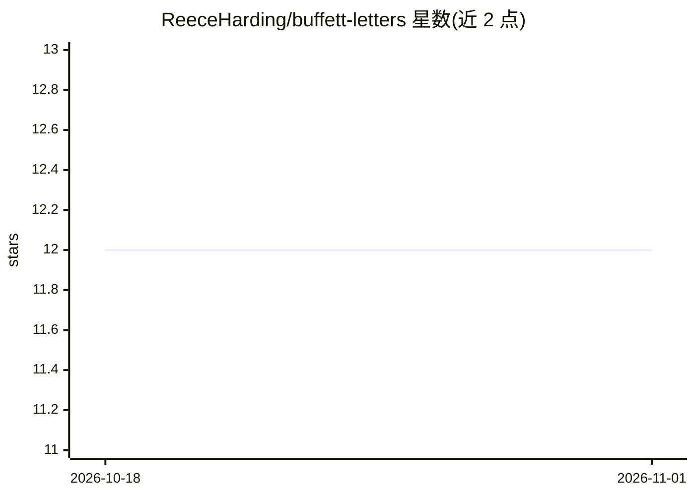

# ReeceHarding/buffett-letters

⭐ 12 · Python · 推送 2026-03-21 · [GitHub](https://github.com/ReeceHarding/buffett-letters) · 个人维护

**巴菲特致股东信全集（1977–2024）的 Markdown 格式档案**

收录 Warren Buffett 写给 Berkshire Hathaway 股东的全部 48 封年度信件（1977–2024），从原网站 HTML/PDF 统一转换为纯文本 Markdown，每封信为按年份命名的独立文件，无依赖、无需预处理。定位是便于阅读、跨年份全文检索，以及接入 LLM 或 RAG 流水线。附带脚本可用 requests/bs4/pdfplumber 从原站重新生成全集，已下载文件会被跳过可安全重跑。内容为 Berkshire Hathaway 版权，仅供教育与研究用途。

## 筛选速览

| 维度 | 判定 | 备注 |
|---|---|---|
| AI 角色 | `ai-knowledge` | 知识聚合/清单类 |
| 许可风险 | `none` | — |
| 部署形态 | `library` | 以包/库形式分发 |
| 模型依赖 | — | README 未给出锁定关系 |
| 硬件要求 | — | 无带数字的原话,不猜 |
| 安装摩擦 | `low` | 无编译、无系统依赖或容器化 |
| 成熟度 | — | 结构信号不足 |

## 能力要点

- 48 封信全部转为统一 Markdown，按年份独立成文件
- 可克隆到本地获得完整档案，无依赖无需预处理
- 附重新生成脚本，增量下载且可安全重跑

## 适用场景

- 跨 48 年全文检索巴菲特致股东信
- 把信件语料接入 LLM 或 RAG 流水线做问答
- 无需 PDF 阅读器直接阅读原始信件全文

## 场景标签

 · 领域:金融/知识数据集

## 证据(README 行号)

> L3: All 48 annual letters from Warren Buffett to Berkshire Hathaway shareholders, converted to plain text Markdown for e
> L11: - Feed them into an LLM or RAG pipeline

## 星数曲线

2026-10-18 12 → 2026-11-01 12（+0）

---
*卡片 v1 · prompt 1.4 · 生成 2026-11-01 · 置信度 mid · 依据 README sha `15ab23f5c5b5` · [字段定义](../../DATASET.md)*
