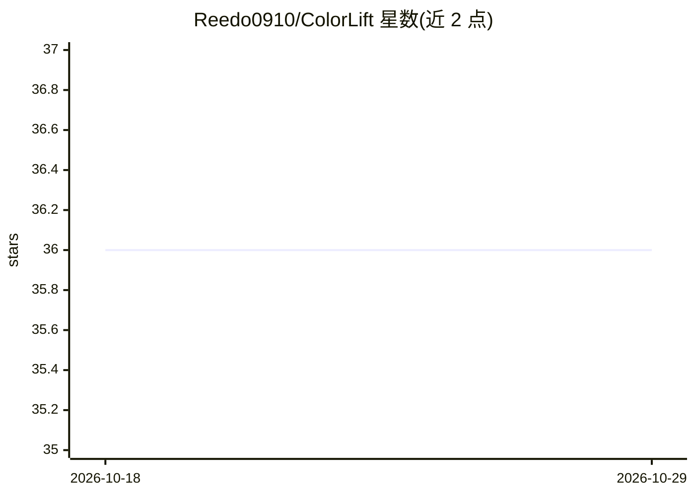

# Reedo0910/ColorLift

⭐ 36 · JavaScript · GPL-3.0 · 推送 2025-11-21 · [GitHub](https://github.com/Reedo0910/ColorLift) · 个人维护 · 中文 README

**AI 生成无障碍颜色描述的跨平台取色工具，面向色觉障碍用户**

基于 Electron 的免费跨平台取色工具（Windows/macOS），用户点击屏幕取色后获得 HEX/RGB/HSL 值，并将颜色文本传给 LLM 生成文字描述（颜色名称、视觉印象、应用场景），帮助色觉障碍者理解颜色。支持 Anthropic、Google、DeepSeek、OpenAI、通义千问等 8 家厂商快速配置及自定义 API，API Key 仅存本地。macOS 未代码签名，首次启动需手动放行；不适用于精确色彩测量。安装包通过 GitHub Release 分发。

## 筛选速览

| 维度 | 判定 | 备注 |
|---|---|---|
| AI 角色 | `ai-native` | 本体是模型或模型工具 |
| 许可风险 | `viral` | GPL-3.0 |
| 部署形态 | `None` |  |
| 模型依赖 | locked-api |  |
| 硬件要求 | — | 无带数字的原话,不猜 |
| 安装摩擦 | `low` | 无编译、无系统依赖或容器化 |
| 成熟度 | — | 结构信号不足 |

## 能力要点

- 一键拾色并生成语境化颜色文字描述
- 8 家 LLM 厂商快速配置 + 自定义 API 接入
- 仅传递 1x1 像素颜色文本给 LLM，API Key 本地存储
- 英文/简中/繁中多语言界面

## 适用场景

- 色觉障碍者了解屏幕上颜色及其使用场景
- 设计师快速获取颜色的文字化描述与含义
- 需要 HEX/RGB/HSL 取值并附带解释的日常取色

## 场景标签

`AI 助手` · 领域:对话与助手

## 证据(README 行号)

> L12: > 通过 AI 生成的颜色文字描述，帮助用户（特别是色觉障碍者）理解屏幕上的颜色及其应用场景。
> L28: - 🤖 **多模型支持**：API 支持 Anthropic (Claude)、Cohere、Google (Gemini)、DeepSeek、科大讯飞星火、通义千问（Qwen）、OpenAI (GPT) 和智谱 AI 的快速配置

## 星数曲线

2026-10-18 36 → 2026-10-29 36（+0）

---
*卡片 v1 · prompt 1.4 · 生成 2026-10-25 · 置信度 high · 依据 README sha `8c106215c426` · [字段定义](../../DATASET.md)*
