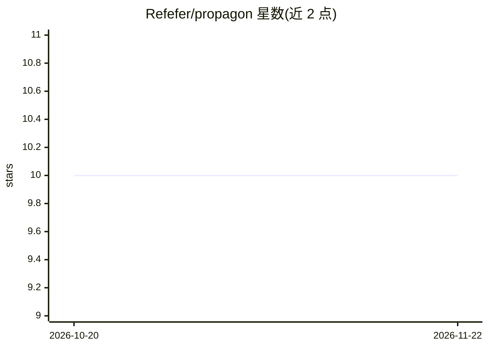

# Refefer/propagon

⭐ 10 · Rust · Apache-2.0 · 推送 2026-06-14 · [GitHub](https://github.com/Refefer/propagon) · 个人维护

**从比较数据计算排名的 Rust 库与 CLI 工具**

propagon 以 Rust 库和命令行工具形式提供，将胜负对比、评委选票、网页链接、A/B 测试奖励等比较数据转换为排名。算法覆盖胜率、Bradley-Terry、Elo、Glicko-2、排名聚合、图中心性、多臂老虎机与轨迹价值估计等类别，并提供选择指南；贝叶斯模型支持不确定性量化（可信区间），部分算法支持在线增量更新。需要 Rust 1.88+，从源码构建，详细 API 与 CLI 参考在 DEVELOPER.md。

## 筛选速览

| 维度 | 判定 | 备注 |
|---|---|---|
| AI 角色 | `ai-native` | 本体是模型或模型工具 |
| 许可风险 | `permissive` | Apache-2.0 |
| 部署形态 | `library` | 以包/库形式分发 |
| 模型依赖 | — | README 未给出锁定关系 |
| 硬件要求 | — | 无带数字的原话,不猜 |
| 安装摩擦 | `medium` | 含编译或系统依赖之一 |
| 成熟度 | — | 结构信号不足 |

## 能力要点

- 内置多类排名算法：Bradley-Terry、Elo/Glicko-2、Borda/Kemeny、PageRank/HITS、多臂老虎机等
- 贝叶斯 Bradley-Terry 输出后验强度与 95% 可信区间，支持稀疏数据正则化
- 支持增量在线更新（Elo、Glicko-2）与 Whole-History Rating 历史曲线
- 行为克隆可将专家日志转为偏好对并导出供下游排名器使用

## 适用场景

- 从棋类或电竞比赛结果生成选手排行榜
- 对评委排序结果做排名聚合
- 从链接、引用网络计算节点中心性排名
- A/B 测试与广告选择中的多臂老虎机决策

## 场景标签

 · 领域:机器学习/排名与图算法

## 证据(README 行号)

> L7: Propagon is a Rust library and command-line tool that turns messy comparison data into rankings. Feed it head-to-hea
> L41: |Head-to-head match results (winner/loser pairs)|**Tournament algorithms** — Win Rate, Bradley-Terry, Elo, Glicko-2

## 星数曲线

2026-10-20 10 → 2026-11-22 10（+0）

---
*卡片 v1 · prompt 1.4 · 生成 2026-11-20 · 置信度 high · 依据 README sha `7347495346a7` · [字段定义](../../DATASET.md)*
