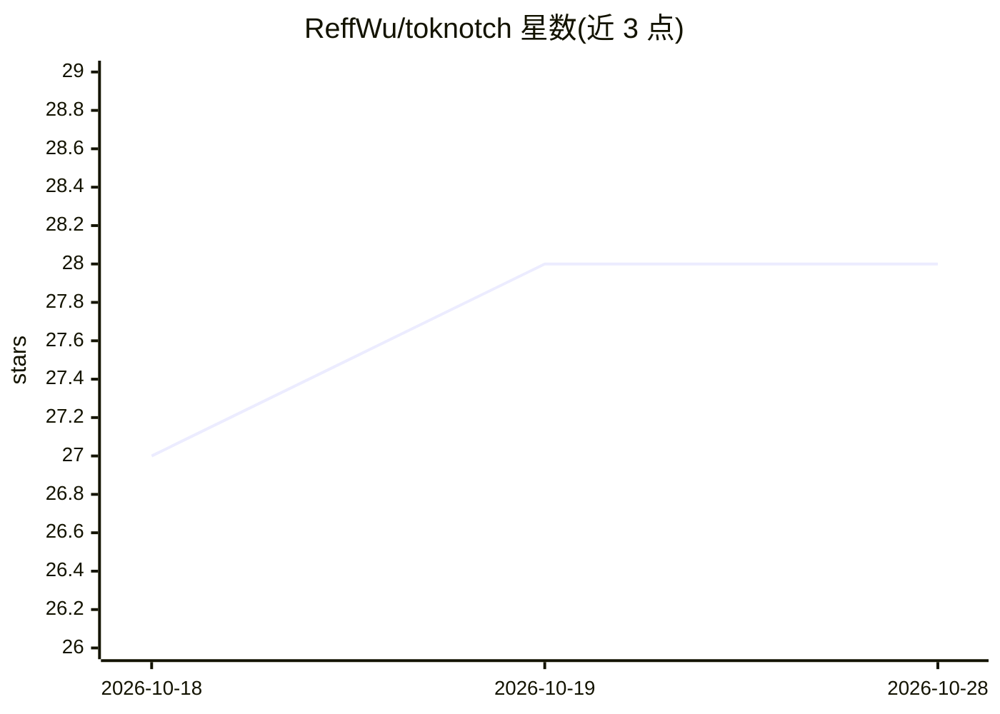

# ReffWu/toknotch

⭐ 28 · Swift · MIT · 推送 2026-10-11 · [GitHub](https://github.com/ReffWu/toknotch) · [官网](https://github.com/ReffWu/toknotch) · 个人维护

**Mac 刘海区显示 AI 订阅回本倍数与 token 用量的工具**

SwiftUI 编写的 macOS 菜单栏/屏幕边缘应用：读取本机编码工具（Claude Code、Codex 等）已写下的会话日志，统计实际 token 用量并按公开 API 价格折算，与用户设定的订阅费用对比，得出回本倍数或剩余金额；统计内核为内置的 tokscale 二进制。按真实账单周期而非自然月计数，按模型厂商（Anthropic/OpenAI/DeepSeek/Qwen 等 13 家）分组显示。无需账号、API key，数据不出本机。提供签名公证的 dmg 下载，要求 macOS 14 以上。

## 筛选速览

| 维度 | 判定 | 备注 |
|---|---|---|
| AI 角色 | `ai-ecosystem` | LLM/agent 周边工具 |
| 许可风险 | `permissive` | MIT |
| 部署形态 | `desktop` | 安装包/桌面程序 |
| 模型依赖 | — | README 未给出锁定关系 |
| 硬件要求 | — | 无带数字的原话,不猜 |
| 安装摩擦 | `low` | 无编译、无系统依赖或容器化 |
| 成熟度 | — | 结构信号不足 |

## 能力要点

- 按公开 API 费率将订阅实际用量折算为回本倍数
- 读取本机会话日志统计，无需账号/API key，数据不出本机
- 按真实账单周期计数，按 13 家模型厂商分组显示 token 三环
- 支持 17 种语言的数字/货币/日期本地化惯例

## 适用场景

- 查看我的 AI 订阅相对 API 计费是否划算
- 在屏幕边缘常驻查看今日/本月/累计 token 用量
- 分别追踪不同厂商模型的本地与订阅用量

## 场景标签

`LLM 可观测性` · 领域:评测与运维

## 证据(README 行号)

> L24: TokNotch adds up everything your coding tools actually ran, prices it at what
> L71: The counting is done by tokscale, which

## 星数曲线

2026-10-18 27 → 2026-10-28 28（+1）

---
*卡片 v1 · prompt 1.4 · 生成 2026-10-26 · 置信度 high · 依据 README sha `b33581546f4b` · [字段定义](../../DATASET.md)*
