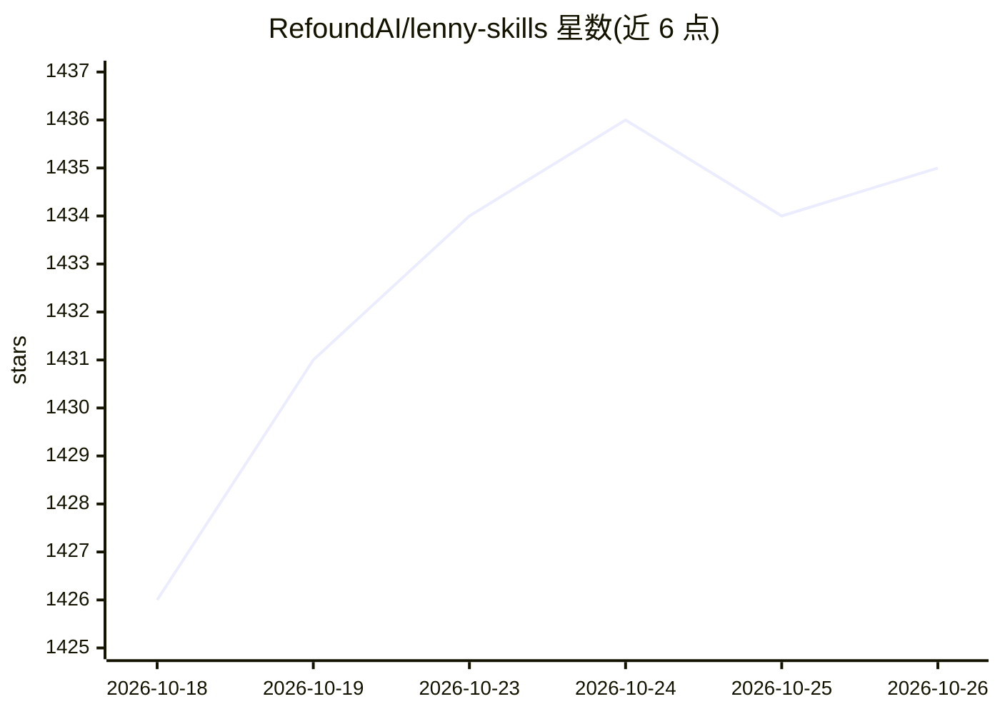

# RefoundAI/lenny-skills

⭐ 1,435 · MIT · 推送 2026-07-16 · [GitHub](https://github.com/RefoundAI/lenny-skills) · 组织维护

**Lenny's Podcast 提炼的 76 个产品管理技能包，供 Claude Code 等 AI agent 使用**

由 Refound AI 策展的 SKILL.md 格式技能集合：从 Lenny's Podcast 与 Newsletter 共 597 期内容中提炼 76 个产品管理与工程技能，每条引语经原文逐字核验。技能按产品组织运营模型分组（战略、规划、发现、构建、发布、增长、团队、运营节奏及垂直 playbook 与职业发展），每个技能附带框架、清单与模板。安装方式为将技能文件夹复制到项目的 .claude/skills/ 目录，供 Claude Code 及任何读取 SKILL.md 的 agent 使用。

## 筛选速览

| 维度 | 判定 | 备注 |
|---|---|---|
| AI 角色 | `ai-knowledge` | 知识聚合/清单类 |
| 许可风险 | `permissive` | MIT |
| 部署形态 | `None` |  |
| 模型依赖 | — | README 未给出锁定关系 |
| 硬件要求 | — | 无带数字的原话,不猜 |
| 安装摩擦 | `low` | 无编译、无系统依赖或容器化 |
| 成熟度 | — | 结构信号不足 |

## 能力要点

- 76 个技能，源自 597 期播客与文章、4,019 条有出处洞察
- 每个技能附 references/artifacts.md 中的框架、清单与模板
- 引语逐字核验原文，无转述偏移
- 按产品组织运营模型分组并含 AI 产品、市场平台等垂直 playbook

## 适用场景

- 在 Claude Code 中获得产品战略、用户研究、定价等领域的专业工作流
- 为 AI agent 添加结构化的产品管理知识与模板
- 按职能阶段（发现、构建、发布、增长、团队管理）查找对应技能

## 场景标签

`提示工程` `精选清单` · 领域:Agent 开发

## 证据(README 行号)

> L6: **76 product management and engineering skills**, distilled from the full archive of Lenny's Podcast and Lenny's New
> L19: Skills are markdown files that give AI agents specialized knowledge and workflows. Add them to your project and Cla

## 星数曲线

2026-10-18 1,426 → 2026-10-26 1,435（+9）

---
*卡片 v1 · prompt 1.4 · 生成 2026-10-21 · 置信度 high · 依据 README sha `fe2c833b079e` · [字段定义](../../DATASET.md)*
