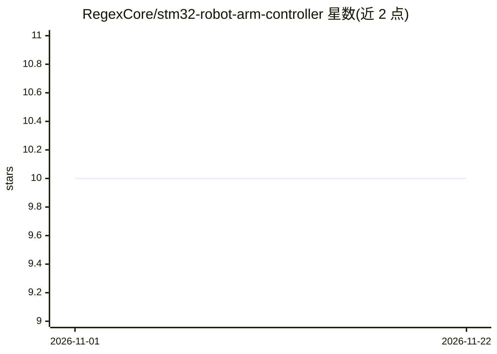

# RegexCore/stm32-robot-arm-controller

⭐ 10 · C · MIT · 推送 2026-10-15 · [GitHub](https://github.com/RegexCore/stm32-robot-arm-controller) · 个人维护

**STM32 6自由度机械臂固件：运动学控制+AI 辅助桥接**

基于 STM32F446RE 的 6-DOF 机械臂嵌入式固件，C 驱动与 C++ 应用逻辑分层的模块化架构。支持摇杆手动控制与逆解自动定位，含舵机插值、急停、100 Hz 定时器中断控制环、DMA 采集。舵机经 I²C PCA9685 驱动，HC-05 蓝牙用于远程指令与状态查询。AI 控制通过外部 MCP host bridge 实现，固件本身不含 AI 模型。个人嵌入式 C/C++ 与机器人学训练项目。

## 筛选速览

| 维度 | 判定 | 备注 |
|---|---|---|
| AI 角色 | `ai-enhanced` | 去掉 AI 部分产品仍成立 |
| 许可风险 | `permissive` | MIT |
| 部署形态 | `None` |  |
| 模型依赖 | — | README 未给出锁定关系 |
| 硬件要求 | — | 无带数字的原话,不猜 |
| 安装摩擦 | `low` | 无编译、无系统依赖或容器化 |
| 成熟度 | — | 结构信号不足 |

## 能力要点

- 正/逆运动学计算与笛卡尔目标定位
- PCA9685 I²C 舵机驱动 + HC-05 蓝牙双向通信
- 低耦合、依赖注入的分层 C/C++ 架构
- 外部 MCP host bridge 提供 AI 辅助控制

## 适用场景

- 学习 STM32 嵌入式 C/C++ 固件架构设计
- 复现机械臂手动/自动运动学控制
- 通过 MCP host 用 AI 辅助操控机械臂

## 场景标签

 · 领域:嵌入式/机器人

## 证据(README 行号)

> L3: Embedded firmware for a **6-DOF robotic arm with gripper** based on an STM32 microcontroller.
> L16: - **Bluetooth and AI integration:** Bidirectional HC-05 communication for remote motion commands and status queries

## 星数曲线

2026-11-01 10 → 2026-11-22 10（+0）

---
*卡片 v1 · prompt 1.4 · 生成 2026-11-20 · 置信度 high · 依据 README sha `0fb12417b1d8` · [字段定义](../../DATASET.md)*
