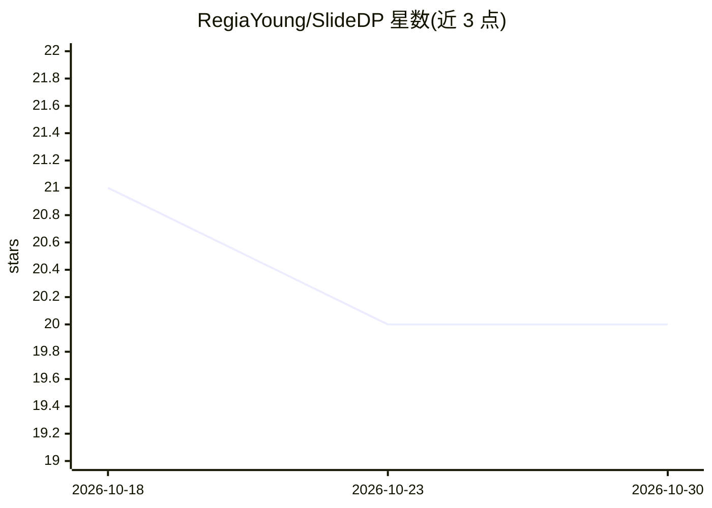

# RegiaYoung/SlideDP

⭐ 20 · Python · Apache-2.0 · 推送 2026-09-29 · [GitHub](https://github.com/RegiaYoung/SlideDP) · 个人维护

**多 GPU 共享主机内存的 LLM 全参数微调运行时**

SlideDP 是面向主机驻留模型状态的 LLM 全参数微调的同步数据并行运行时：通过层流式传输让超出 GPU 内存的模型可训练，围绕共享权威主机状态协调参数投递、梯度聚合与 CPU 更新，支持复制或分片参数投递、CPU/GPU 侧梯度归约，并用跨 rank 流水线重叠数据搬运与计算。本次代码发布仅包含 baselines/slideformer_dp/ 中的 SlideFormer 多 GPU 参考扩展，论文所用的优化运行时尚未发布，计划后续更新。供安装 CUDA 版 PyTorch 后经 pip 与 torchrun 运行，支持 Qwen/Llama/Mistral/Gemma 等模型家族，多模态支持仍在开发中。

## 筛选速览

| 维度 | 判定 | 备注 |
|---|---|---|
| AI 角色 | `ai-ecosystem` | LLM/agent 周边工具 |
| 许可风险 | `permissive` | Apache-2.0 |
| 部署形态 | `library` | 以包/库形式分发 |
| 模型依赖 | — | README 未给出锁定关系 |
| 硬件要求 | — | 无带数字的原话,不猜 |
| 安装摩擦 | `medium` | 含编译或系统依赖之一 |
| 成熟度 | `idea` | |

## 能力要点

- 层流式传输支持超出 GPU 内存的全参数微调
- 复制/分片参数投递与 CPU/GPU 侧梯度归减可配置
- 跨 rank 流水线重叠数据搬运、CPU 更新与 GPU 计算
- 解析式步时模型在 GPU 内存预算下指导通信与分块策略

## 适用场景

- GPU 显存不足时对大模型做全参数微调
- 在多 GPU 共享主机内存的拓扑下配置训练通信路线
- 复现论文的多 GPU 数据并行参考实现

## 场景标签

`微调` · 领域:训练与推理

## 证据(README 行号)

> L9: SlideDP is a synchronous data-parallel runtime for full-parameter LLM
> L15: SlideDP coordinates parameter delivery, gradient aggregation, and CPU updates

## 星数曲线

2026-10-18 21 → 2026-10-30 20（-1）

---
*卡片 v1 · prompt 1.4 · 生成 2026-10-28 · 置信度 high · 依据 README sha `e42106bce7e7` · [字段定义](../../DATASET.md)*
