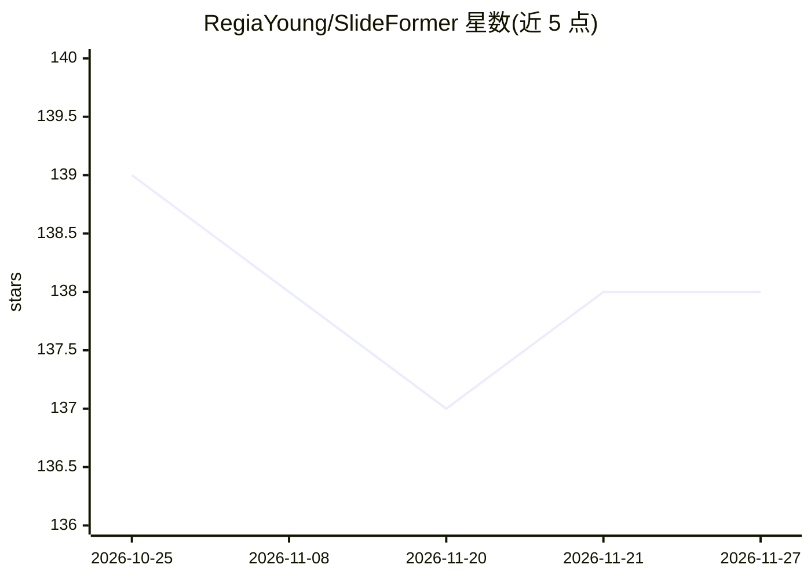

# RegiaYoung/SlideFormer

⭐ 138 · Python · Apache-2.0 · 推送 2026-10-28 · [GitHub](https://github.com/RegiaYoung/SlideFormer) · [官网](https://dl.acm.org/doi/10.1145/3770743.3804125) · 个人维护

**单 GPU 全参数微调 LLM 的异构运行时，卸载至 CPU/NVMe**

基于 PyTorch 的异构运行时，面向在单张 GPU 上对大模型做全参数微调的用户。机制上协同设计层滑动执行、GPU/CPU RAM/可选 NVMe 三级内存管理与异步传输-计算流水线，仅将活跃层窗口驻留 GPU，训练状态保存在 CPU 内存。提供 dummy 数据校验、真实数据微调示例、正确性验证与基准脚本，多 GPU 参考扩展置于 multi_gpu/ 目录。README 给出的吞吐与显存数据均来自作者自述评估。

## 筛选速览

| 维度 | 判定 | 备注 |
|---|---|---|
| AI 角色 | `ai-ecosystem` | LLM/agent 周边工具 |
| 许可风险 | `permissive` | Apache-2.0 |
| 部署形态 | `library` | 以包/库形式分发 |
| 模型依赖 | — | README 未给出锁定关系 |
| 硬件要求 | — | 无带数字的原话,不猜 |
| 安装摩擦 | `medium` | 含编译或系统依赖之一 |
| 成熟度 | `idea` | |

## 能力要点

- 层滑动执行：仅活跃层窗口驻留 GPU，支持超出显存容量的模型全参数微调
- 异步引擎重叠 GPU 计算、CPU 优化器更新、H2D/D2H 传输与可选 NVMe I/O
- 提供 DeepSpeed ZeRO-3 参考的正确性验证与基准脚本（bench/）
- 2026.06 起提供分块重叠流水线与 multi_gpu/ 多卡参考扩展

## 适用场景

- 在单张消费级 GPU 上对 Qwen/Llama 系模型做全参数微调
- 显存不足时通过 CPU RAM/NVMe 卸载继续训练大模型
- 复现论文中的吞吐与显存基准对比实验

## 场景标签

`微调` · 领域:训练与推理

## 证据(README 行号)

> L18: **SlideFormer** is a PyTorch-based heterogeneous runtime for full-parameter
> L20: heterogeneous memory management, and asynchronous transfer/compute pipelines
> L246: We support full-parameter fine-tuning across a wide range of Hugging Face language models.

## 星数曲线

2026-10-25 139 → 2026-11-27 138（-1）

---
*卡片 v1 · prompt 1.4 · 生成 2026-11-27 · 置信度 mid · 依据 README sha `d615e78341ae` · [字段定义](../../DATASET.md)*
