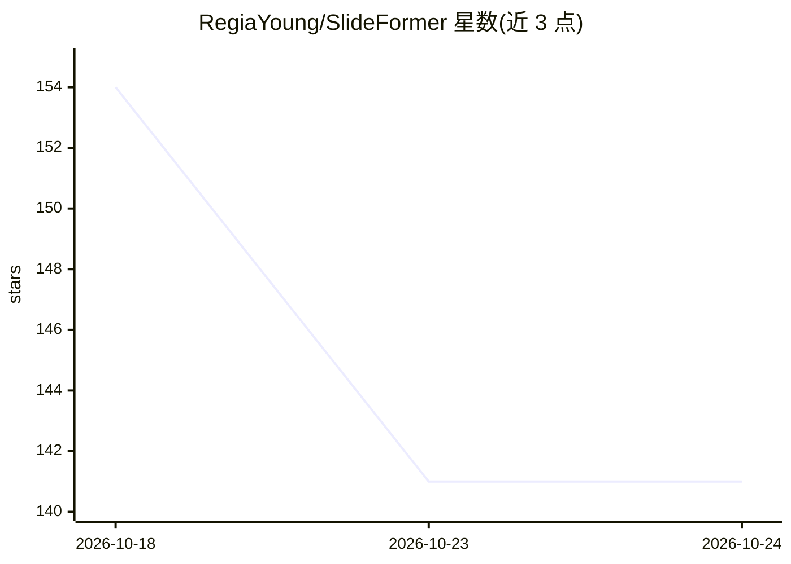

# RegiaYoung/SlideFormer

⭐ 141 · Python · Apache-2.0 · 推送 2026-09-29 · [GitHub](https://github.com/RegiaYoung/SlideFormer) · [官网](https://arxiv.org/abs/2603.16428) · 个人维护

**单 GPU 全参数微调 LLM 的异构卸载训练运行时**

基于 PyTorch 的异构训练运行时，面向单张商品 GPU 上的 LLM 全参数微调：GPU 上仅物化紧凑的活动层窗口，持久训练状态保存在 CPU 内存，通过层滑动执行、异步传输/计算流水线协调 GPU 显存、CPU 内存与可选 NVMe 存储。评测报告吞吐为相关卸载基线的 1.40×–6.27×、峰值 GPU 内存降低至多 50%，支持在单 GPU 上微调 100B+ 模型。提供 conda/pip 安装、dummy 数据校验、真实数据微调与基准脚本，正确性以 DeepSpeed ZeRO-3 CPU-offload 为参照；多 GPU 扩展以参考实现形式提供。支持 Qwen/Llama/Mistral/Gemma 系列。

## 筛选速览

| 维度 | 判定 | 备注 |
|---|---|---|
| AI 角色 | `ai-ecosystem` | LLM/agent 周边工具 |
| 许可风险 | `permissive` | Apache-2.0 |
| 部署形态 | `library` | 以包/库形式分发 |
| 模型依赖 | — | README 未给出锁定关系 |
| 硬件要求 | — | 无带数字的原话,不猜 |
| 安装摩擦 | `medium` | 含编译或系统依赖之一 |
| 成熟度 | — | 结构信号不足 |

## 能力要点

- 层滑动执行：GPU 仅驻留活动层窗口，可训练超出显存容量的模型
- 协调 GPU 显存、CPU 内存与可选 NVMe 的异步传输/计算流水线
- 评测支持单 GPU 全参数微调 100B+ 模型，峰值 GPU 内存降低至多 50%
- 支持 Qwen2/2.5/3/3.6、Llama 3.x、Mistral、Gemma 4 系列

## 适用场景

- 在单张消费级 GPU 上对大模型做全参数微调
- 显存/内存受限环境下训练超出 GPU 显存的模型
- 长序列（如 64K 上下文）训练场景
- 复现论文基准并与 DeepSpeed/ColossalAI 等基线对比

## 场景标签

`微调` · 领域:训练与推理

## 证据(README 行号)

> L17: **SlideFormer** is a PyTorch-based heterogeneous runtime for full-parameter
> L18: fine-tuning on a single GPU. It co-designs layer-sliding execution,

## 星数曲线

2026-10-18 154 → 2026-10-24 141（-13）

---
*卡片 v1 · prompt 1.4 · 生成 2026-10-23 · 置信度 mid · 依据 README sha `23f871231e4e` · [字段定义](../../DATASET.md)*
