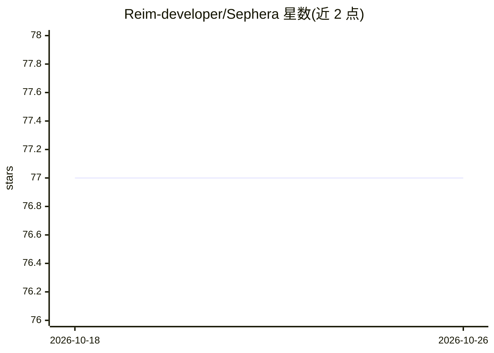

# Reim-developer/Sephera

⭐ 77 · Rust · GPL-3.0 · 推送 2026-10-24 · [GitHub](https://github.com/Reim-developer/Sephera) · [官网](https://sephera.vercel.app) · 个人维护

**回答“改这个文件会破坏什么”的 Rust CLI：反向依赖分析与 LLM 上下文打包**

从代码库的 import/use/#include 语句构建真实依赖图，提供 impact（爆炸半径）、graph（含反向查询与 diff 模式）、context（token 预算的 LLM 上下文包，Tree-sitter AST 压缩）、loc（按语言行数统计）四个子命令，并内置 MCP server。支持 Rust/Python/TypeScript/Go/Java/C/C++ 等语言，提供 CI 阈值门禁（--fail-on 独立退出码）。准确性在三个真实仓库的固定 commit 上以 CI 断言度量。以 cargo install 或预编译二进制分发，当前版本 v0.5.0（pre-1.0）。

## 筛选速览

| 维度 | 判定 | 备注 |
|---|---|---|
| AI 角色 | `ai-ecosystem` | LLM/agent 周边工具 |
| 许可风险 | `viral` | GPL-3.0 |
| 部署形态 | `library` | 以包/库形式分发 |
| 模型依赖 | — | README 未给出锁定关系 |
| 硬件要求 | — | 无带数字的原话,不猜 |
| 安装摩擦 | `low` | 无编译、无系统依赖或容器化 |
| 成熟度 | `idea` | |

## 能力要点

- impact/graph 子命令给出传递性反向依赖与爆炸半径
- 迭代 DFS 环检测，声明边与依赖边按类别区分处理
- token 预算上下文包：Tree-sitter 压缩保留签名/类型/导入，输出确定性可复现
- CI 门禁：--fail-on-cycles 等阈值以独立退出码（2）报告违规

## 适用场景

- 改动共享模块前先查清哪些文件会被破坏
- 在 CI 中用环检测阈值门禁拦截循环依赖
- 把聚焦子树压缩进 token 预算，喂给 LLM 或 MCP 客户端
- 对比 PR 中每个被改文件的爆炸半径

## 场景标签

 · 领域:开发者工具/代码分析

## 证据(README 行号)

> L262: ### `context` — token-budgeted packs for LLMs
> L191: |MCP server|✅|✅|❌|

## 星数曲线

2026-10-18 77 → 2026-10-26 77（+0）

---
*卡片 v1 · prompt 1.4 · 生成 2026-10-24 · 置信度 high · 依据 README sha `6aa98673b446` · [字段定义](../../DATASET.md)*
