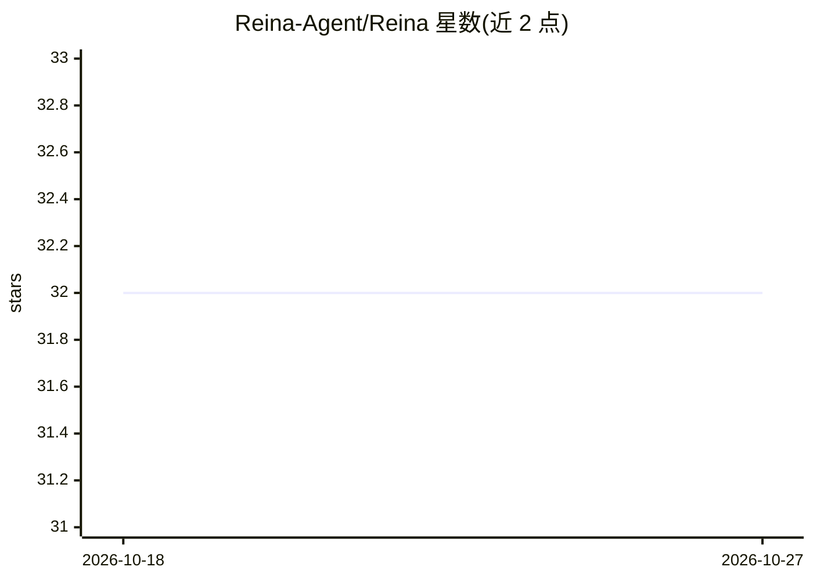

# Reina-Agent/Reina

⭐ 32 · AGPL-3.0 · 推送 2026-09-10 · [GitHub](https://github.com/Reina-Agent/Reina) · [官网](https://github.com/Reina-Agent/Reina/releases/latest) · 个人维护 · 中文 README

**开源桌面 AI Agent：自带模型、多智能体协作与 MCP 技能**

基于 Electron/React 的开源桌面 AI Agent 应用：围绕本地工作区维持持续会话，理解项目文件并推进多步任务；协调者 Agent 将目标分解为 DAG 子任务并调度子 Agent 分阶段完成。支持接入 MCP 服务器与技能市场，用户自带模型与 API key（存于 ~/.reina/），无云端后端；副作用操作经审批提示，过程可暂停恢复。提供 Windows/macOS 安装包与应用内自动更新，也可用 Node.js 从源码构建。

## 筛选速览

| 维度 | 判定 | 备注 |
|---|---|---|
| AI 角色 | `ai-native` | 本体是模型或模型工具 |
| 许可风险 | `dual` | AGPL-3.0 |
| 部署形态 | `library` | 以包/库形式分发 |
| 模型依赖 | — | README 未给出锁定关系 |
| 硬件要求 | — | 无带数字的原话,不猜 |
| 安装摩擦 | `low` | 无编译、无系统依赖或容器化 |
| 成熟度 | — | 结构信号不足 |

## 能力要点

- 多 Agent 团队模式：协调者分解 DAG 子任务并驱动子 Agent 通过阶段门
- 自带模型层（BYOM/BYOK），密钥本地存储，无产品服务器与云后端
- MCP 与技能市场，可在任务中自行搜索安装新技能
- 权限审批、会话持久化与上下文压缩

## 适用场景

- 在本地桌面环境中让 AI Agent 理解并推进我的项目任务
- 把一个目标拆给多个子 Agent 协作完成
- 自带模型和 API key 使用，数据不经厂商后端

## 场景标签

`AI 助手` `多智能体` `编码 Agent` · 领域:Agent 开发

## 证据(README 行号)

> L5: ### A desktop AI agent — multi-agent teams, MCP & Skills, bring your own models
> L19: **Reina is an open-source desktop AI agent.** It holds a continuous conversation around your local workspace — unde
> L27: - 🤝 **Multi-agent team mode** — a coordinator agent decomposes a goal into a DAG of subtasks and drives worker agen

## 星数曲线

2026-10-18 32 → 2026-10-27 32（+0）

---
*卡片 v1 · prompt 1.4 · 生成 2026-10-26 · 置信度 high · 依据 README sha `34c62a8ba3fb` · [字段定义](../../DATASET.md)*
