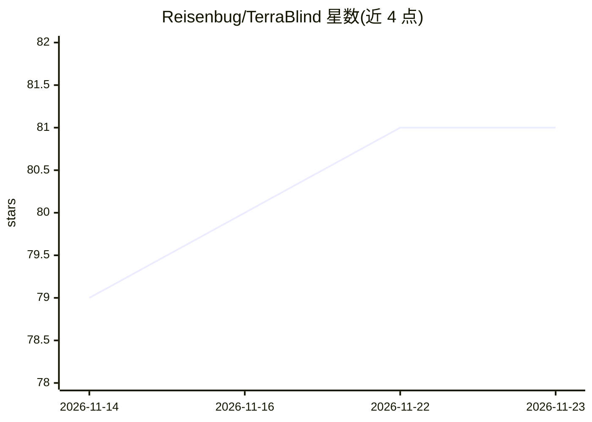

# Reisenbug/TerraBlind

⭐ 81 · C# · MIT · 推送 2026-11-22 · [GitHub](https://github.com/Reisenbug/TerraBlind) · 个人维护 · 中文 README

**在 Terraria 中实时游玩的 AI Agent（tModLoader 模组）**

运行于 tModLoader 的 Terraria 模组，让 AI 以自然语言目标在游戏中持续行动：LLM 负责调查世界与配方、构建任务 DAG 并编写可执行 JavaScript（Code as Policies），Jev 决策模型负责 Boss 战等现场的快速类型化判断，游戏执行层处理感知、寻路、挖掘、瞄准与逐帧操作。使用需安装 Terraria 与 tModLoader，并配置本机 Codex、OpenAI 兼容 API 及 TypeSafe API Key。复杂长任务的稳定性与失败恢复仍在迭代。源码含 dotnet 测试工程与独立开发客户端脚本，MIT 许可。

## 筛选速览

| 维度 | 判定 | 备注 |
|---|---|---|
| AI 角色 | `ai-native` | 本体是模型或模型工具 |
| 许可风险 | `permissive` | MIT |
| 部署形态 | `None` |  |
| 模型依赖 | — | README 未给出锁定关系 |
| 硬件要求 | — | 无带数字的原话,不猜 |
| 安装摩擦 | `medium` | 含编译或系统依赖之一 |
| 成熟度 | `idea` | |

## 能力要点

- 慢循环（LLM 规划/编写策略）+ 快循环（Jev 现场判断 + 执行层逐帧控制）架构
- Agent 编写 JavaScript 策略，支持任务 DAG、后台动作、事件反应与技能库
- Jev 驱动大师模式 Boss 战，Boss 策略可通过 BossPlaybook 配置调整
- 内置 Codex 后端自动启动本机 codex app-server，另支持 OpenAI 兼容 API

## 适用场景

- 用自然语言下达目标让 AI 自动采集、制作装备并挑战 Boss
- 研究 LLM 慢速推理驱动实时游戏行动的连贯性与执行机制
- 在 Terraria 中复现速通肉山等固定流程演示

## 场景标签

 · 领域:游戏 AI/Agent

## 证据(README 行号)

> L7: TerraBlind 是一个以 Terraria 为载体的实时游戏 Agent 项目，运行于 tModLoader。LLM 负责规划、调查和编写行为脚本，Jev 负责快速情境判断，游戏执行层负责感知、寻路、瞄准与逐帧操作。
> L37: 模型思考需要时间，游戏世界每一帧都在变化。TerraBlind 探索的是：**如何让耗时的高层推理，驱动连贯、及时、能处理变化的实时行动。**
> L73: 这是一种 **Code as Policies** 的思路：模型把行为写成在游戏里运行的程序，再根据新事实修改它。

## 星数曲线

2026-11-14 79 → 2026-11-23 81（+2）

---
*卡片 v1 · prompt 1.4 · 生成 2026-11-18 · 置信度 high · 依据 README sha `b3b63724a452` · [字段定义](../../DATASET.md)*
