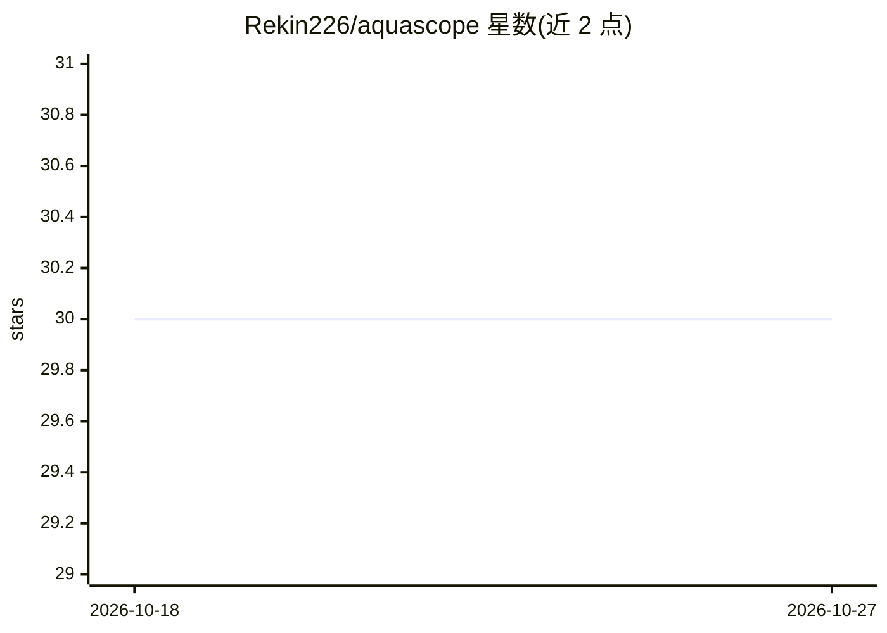

# Rekin226/aquascope

⭐ 30 · Python · MIT · 推送 2026-10-26 · [GitHub](https://github.com/Rekin226/aquascope) · [官网](https://rekin226-aquascope-explorer.static.hf.space/) · 个人维护

**浏览器端水文数据分析工具：统一37个全球水数据源并自动执行分析流程**

将37个全球水数据源统一到一个 Python schema，在其上提供洪水频率分析、FAO-56 作物需水等科研方法，并由 AI 引擎对照数据集对27种研究方法打分、自动执行26条分析流水线。核心工作流无需 API key（playbook 规划、模板撰写），提供浏览器版 Explorer 与本地 Studio：Studio 以问答式引导生成含 Word 报告、Excel、图表与 notebook 的研究包。另提供 MCP 服务器接入 Claude 等 AI 客户端。数据覆盖与预报能力以模型模拟与实测区分标注。

## 筛选速览

| 维度 | 判定 | 备注 |
|---|---|---|
| AI 角色 | `ai-enhanced` | 去掉 AI 部分产品仍成立 |
| 许可风险 | `permissive` | MIT |
| 部署形态 | `library` | 以包/库形式分发 |
| 模型依赖 | locked-api |  |
| 硬件要求 | — | 无带数字的原话,不猜 |
| 安装摩擦 | `low` | 无编译、无系统依赖或容器化 |
| 成熟度 | — | 结构信号不足 |

## 能力要点

- 37个全球水数据源统一为一个 Python API
- AI 引擎评分27种研究方法并自动执行26条分析流水线
- Studio 生成可复现研究包（Word/Excel/notebook/YAML），无 key 也能运行
- 提供 MCP 工具（find_stations、flood_frequency 等）接入 Claude 等 MCP 客户端
- 回归测试含 CAMELS 基准、3,200+ 项测试

## 适用场景

- 查找某个水文测站的数据、可用时段并导出 CSV 或 HEC-RAS/SWMM 等模型输入
- 回答'这里的洪水是否在变严重'并产出可复现的研究报告
- 在浏览器中浏览全球河流状况、洪水预报与月度通报
- 让 Claude 等 MCP 客户端直接查询测站与运行分析

## 场景标签

`数据分析` `科研工具` · 领域:效率与自动化

## 证据(README 行号)

> L36: AquaScope unifies **37 global water-data sources** behind one Python schema, then layers a full scientific computin
> L108: Prefer an assistant? `pip install "aquascope[mcp]"` then `claude mcp add aquascope -- aquascope mcp` gives Claude 
> L131: It needs no key: the playbooks plan and the templates write. If you have one, the Studio asks: paste it

## 星数曲线

2026-10-18 30 → 2026-10-27 30（+0）

---
*卡片 v1 · prompt 1.4 · 生成 2026-10-26 · 置信度 high · 依据 README sha `ffa7e9fd9f49` · [字段定义](../../DATASET.md)*
