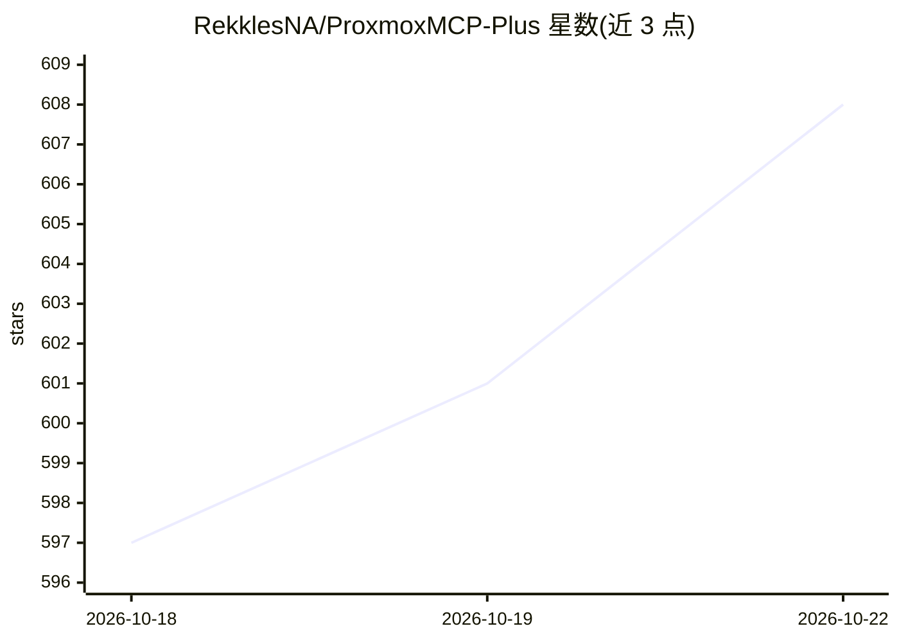

# RekklesNA/ProxmoxMCP-Plus

⭐ 611 · Python · MIT · 推送 2026-10-22 · [GitHub](https://github.com/RekklesNA/ProxmoxMCP-Plus) · [官网](https://github.com/RekklesNA/ProxmoxMCP-Plus#readme) · 个人维护

**让 LLM 与 AI agent 通过 MCP/OpenAPI 安全操控 Proxmox VE**

面向 Proxmox VE 虚拟化环境的安全控制平面：以 MCP（stdio/原生 HTTP）与 OpenAPI 两种入口向 Claude Desktop、Cursor、Open WebUI 等 MCP 客户端和 HTTP 自动化工具暴露同一组运维操作，覆盖 VM/LXC 生命周期、快照、备份、ISO、存储与集群检查、SSH 容器命令执行及异步任务跟踪（UPID 轮询、审计）。安全机制包括 Proxmox API token、bearer auth、命令策略、审批 token、TLS 校验、MCP 工具白/黑名单及可选 OAuth PKCE（OAuth 状态存于 PostgreSQL）。可通过 PyPI（uvx/pip）或 Docker Compose 部署，另提供 Code Mode 沙箱执行。

## 筛选速览

| 维度 | 判定 | 备注 |
|---|---|---|
| AI 角色 | `ai-ecosystem` | LLM/agent 周边工具 |
| 许可风险 | `permissive` | MIT |
| 部署形态 | `self-host` | docker 或自建部署 |
| 模型依赖 | — | README 未给出锁定关系 |
| 硬件要求 | — | 无带数字的原话,不猜 |
| 安装摩擦 | `low` | 无编译、无系统依赖或容器化 |
| 成熟度 | — | 结构信号不足 |

## 能力要点

- MCP 与 OpenAPI 双入口暴露同一运维操作面
- 持久化 job_id + Proxmox UPID 跟踪异步任务与审计
- 工具白/黑名单、审批 token、OAuth PKCE（PostgreSQL 状态）等安全机制
- Code Mode 隔离沙箱内通过受控路径调用域工具

## 适用场景

- 在 Claude Desktop/Cursor 中用 agent 管理 homelab 的 VM、LXC 与快照备份
- 通过 OpenAPI 接入 HTTP 仪表盘或 no-code 工作流做 Proxmox 自动化
- 让 AI agent 在带审批与命令策略约束下执行容器 SSH 命令

## 场景标签

`工作流自动化` · 领域:效率与自动化

## 证据(README 行号)

> L31: ProxmoxMCP-Plus sits between AI clients and Proxmox VE so operators do not have to stitch together raw API calls, o
> L35: - `MCP` for Claude Desktop, Cursor, VS Code, Open WebUI, Codex, and other MCP-capable agents

## 星数曲线

2026-10-18 597 → 2026-10-22 608（+11）

---
*卡片 v1 · prompt 1.4 · 生成 2026-10-21 · 置信度 high · 依据 README sha `1b49e41ed2fb` · [字段定义](../../DATASET.md)*
