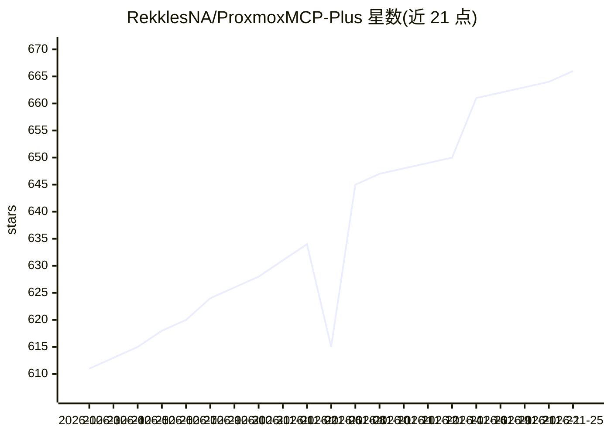

# RekklesNA/ProxmoxMCP-Plus

⭐ 666 · Python · MIT · 推送 2026-11-22 · [GitHub](https://github.com/RekklesNA/ProxmoxMCP-Plus) · [官网](https://github.com/RekklesNA/ProxmoxMCP-Plus#readme) · 个人维护

**供 LLM 与 AI Agent 通过 MCP/OpenAPI 安全操作 Proxmox VE 的控制面**

面向运维者的服务器程序，运行在 AI 客户端与 Proxmox VE 之间，覆盖 VM 与 LXC 生命周期、快照回滚、备份恢复、ISO 下载清理、存储/集群检查、SSH 容器命令执行及异步长任务跟踪。提供 MCP（stdio/HTTP）与 OpenAPI 双入口；安全机制包括 Proxmox API token、bearer 认证、命令策略、审批 token、TLS 校验、工具 allowlist/denylist，以及可选的 OAuth（PKCE）浏览器同意流程，OAuth 状态持久化于 PostgreSQL。安装途径有 PyPI（uvx/pip）与 Docker。

## 筛选速览

| 维度 | 判定 | 备注 |
|---|---|---|
| AI 角色 | `ai-ecosystem` | LLM/agent 周边工具 |
| 许可风险 | `permissive` | MIT |
| 部署形态 | `self-host` | docker 或自建部署 |
| 模型依赖 | — | README 未给出锁定关系 |
| 硬件要求 | — | 无带数字的原话,不猜 |
| 安装摩擦 | `low` | 无编译、无系统依赖或容器化 |
| 成熟度 | — | 结构信号不足 |

## 能力要点

- MCP 与 OpenAPI 双入口共享同一操作面
- 长任务持久化：job_id、UPID 跟踪、轮询、重试、取消与审计历史
- 审批 token、命令策略、TLS 校验与工具过滤等安全控制
- 可选 OAuth 授权码流（PKCE），状态存于 PostgreSQL

## 适用场景

- 在 Claude Desktop 或 Cursor 中对话式管理 Proxmox VM 与 LXC
- 将 Proxmox 运维接入 HTTP 自动化、仪表盘或无代码工作流
- 对异步 Proxmox 任务做持久化跟踪与审计

## 场景标签

 · 领域:基础设施运维/自动化

## 证据(README 行号)

> L5:  Operate Proxmox VE from MCP clients, AI agents, and OpenAPI tooling through one security-conscious control plane fo
> L35: - `MCP` for Claude Desktop, Cursor, VS Code, Open WebUI, Codex, and other MCP-capable agents
> L53: |Dual access paths|Native MCP for agent workflows and OpenAPI for standard HTTP automation|

## 星数曲线

2026-10-23 611 → 2026-11-25 666（+55）

---
*卡片 v1 · prompt 1.4 · 生成 2026-11-24 · 置信度 high · 依据 README sha `5e7d62531c18` · [字段定义](../../DATASET.md)*
