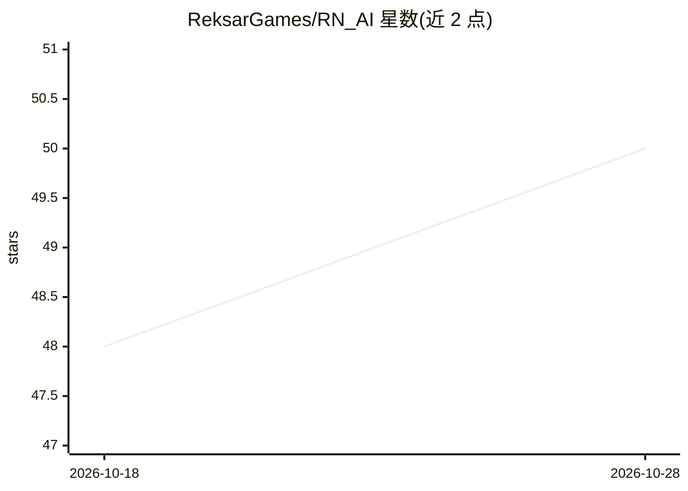

# ReksarGames/RN_AI

⭐ 50 · Python · 推送 2026-02-24 · [GitHub](https://github.com/ReksarGames/RN_AI) · 组织维护

**基于 YOLO 的 FPS/TPS 游戏自瞄助手（Python/GUI）**

Python 实现的 YOLO 目标检测自瞄工具，面向 FPS/TPS 游戏玩家：从屏幕/OBS/采集卡捕获画面，用 YOLO（v8–v12，ONNX/TensorRT）检测目标，经卡尔曼滤波预测与死区逻辑生成瞄准，提供 DearPyGui 图形界面配置检测类别、置信度与瞄准点。支持 Makcu 硬件与输入遮罩。安装经 install.bat（可选 GPU/CPU 向导安装 CUDA 12.8、PyTorch cu128、TensorRT），run.bat 启动。README 明示可能被 VAC/Vanguard 封禁，针对 RTX 20xx 及以上 GPU 优化。

## 筛选速览

| 维度 | 判定 | 备注 |
|---|---|---|
| AI 角色 | `ai-native` | 本体是模型或模型工具 |
| 许可风险 | `none` | — |
| 部署形态 | `None` |  |
| 模型依赖 | — | README 未给出锁定关系 |
| 硬件要求 | — | 无带数字的原话,不猜 |
| 安装摩擦 | `medium` | 含编译或系统依赖之一 |
| 成熟度 | — | 结构信号不足 |

## 能力要点

- YOLO v8–v12 检测，ONNX 全支持、TensorRT 为推荐格式
- 卡尔曼滤波预测、死区逻辑、按类别自定义瞄准点与置信度/IOU
- 屏幕/OBS/采集卡三种捕获源，GUI 全量配置
- Makcu 支持（可选输入遮罩）、Bypass/Driver 控制面板

## 适用场景

- 在 FPS/TPS 游戏中自动检测并追踪目标
- 通过 GUI 调整检测类别、置信度与瞄准参数
- 使用 TensorRT 在 NVIDIA GPU 上运行检测推理

## 场景标签

`目标检测` · 领域:感知与多模态

## 证据(README 行号)

> L3: # 🎯 RN_AI - YOLO Based AI Assistant
> L14: **RN_AI** is a high-performance YOLO-based AI assistant with an intuitive **DearPyGui** interface.
> L134: RN_AI supports multiple YOLO model formats and versions:

## 星数曲线

2026-10-18 48 → 2026-10-28 50（+2）

---
*卡片 v1 · prompt 1.4 · 生成 2026-10-25 · 置信度 high · 依据 README sha `a843a12d7f28` · [字段定义](../../DATASET.md)*
